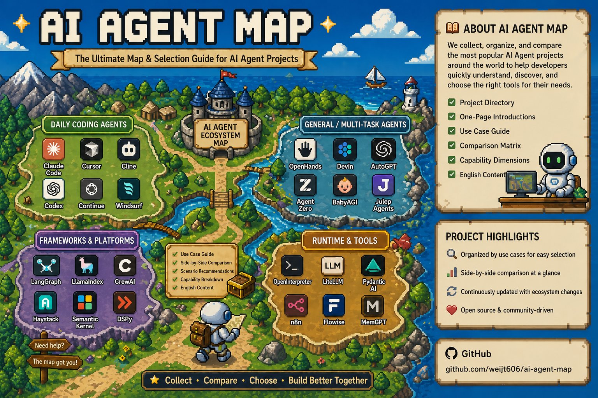

# AI Agent Map

	

AI Agent Map is a practical, visual-first guide for comparing mainstream AI agents, agent platforms, runtimes, and orchestration tools.

The goal is simple: help readers get to a sensible shortlist faster.

## What This Repo Is For

- The agent landscape is crowded.
- Many resources explain ideas, but not fit, anti-fit, or operating cost.
- People usually need a comparison layer, not another pile of links.

This repo stays focused on selection: what a system is good at, where it breaks down, and what kind of operator cost comes with it.

## Where To Start

| If your question is... | Start here |
| --- | --- |
| I need a shortlist first |  |
| I need help choosing for coding automation |  |
| I already have candidates and want a side-by-side view |  |
| I care about dimensions like approval, memory, scheduling, and deployment |  |
| I want every project scored on those dimensions, side by side |  |
| I want to know how capable each model tier is and how agents bill |   |
| My agents already run — I need to know whether they still work |  |
| I want the stock rankings and the weekly trend chart |  |
| I want problem-first guides or the full comparison list |   |

## Recent Heat Ranking

Popularity is not fit.

This table tracks projects that showed up as especially hot in the latest weekly GitHub snapshot. The rank follows the 7-day gain. The total star counts below were checked when this repo was updated.

> **Last updated:** 2026-11-25 · **Snapshot window:** 2026-11-18 → 2026-11-25 (gain since last update: **7 calendar days**, about 7.28 by fetch time against about 7.07 last window, so comparisons below use elapsed time) · **Star counts:** checked at update time

Project names link to the upstream GitHub repo. When this map has a written profile, it is linked separately in the "Map status" column.

| Rank | Project | Current stars | Snapshot gain | Map status | How to read it |
| --- | --- | --- | --- | --- | --- |
| #1&nbsp;(=) | [Orca](https://github.com/stablyai/orca) | 137.5k | +9,266 | In scope · [profile](agents/orca.md) | **Holds #1**, up **38%** on elapsed time to about 8,916 a week, the largest gain on the board this window. It is the **first infra repo to hold #1 for two windows**; [CodeGraph](agents/codegraph.md) held it once, on 06-02. **Past 135k** (137,541). Eleven desktop releases, `v1.4.263`–`v1.4.274` (no `v1.4.270` release), plus Android builds |
| #2&nbsp;(↑) | [Superpowers](https://github.com/obra/superpowers) | 326.4k | +6,753 | In scope · [profile](agents/superpowers.md) | Up **76%** on elapsed time to about 6,498 a week, its fastest rate since the 06-17 → 06-24 window, and up from #8. No commit and no release since Nov 3, so by this board's rule it is a spike until it holds a second window; its 11-04 jump did not. Now **6,314 behind** mattpocock/skills (326,367 against 332,681). **Past 325k** |
| #3&nbsp;(new) | [CLI-Anything](https://github.com/HKUDS/CLI-Anything) | 65.5k | +6,191 | In scope · [profile](agents/cli-anything.md) | **Back after three windows off the board**, up **763%** on elapsed time (+6,191 against +697), its largest raw gain this map has recorded (the previous high was +5,500 over the 6-day window to 05-22, which was a faster weekly rate). The window shows **no commit and no release**, so it is a spike; its 10-21 jump, also unexplained, halved the next window. **Past 65k** (65,465) |
| #4&nbsp;(↓) | [mattpocock/skills](https://github.com/mattpocock/skills) | 332.7k | +5,645 | Watchlist (Skills Wave) | Flat on elapsed time (−5%, about 5,432 a week). **#4 is its lowest seat** in 27 straight windows on the board; it had never been below #3. Its lead over [Superpowers](agents/superpowers.md) narrowed from 7,422 to **6,314**. **Past 330k** (332,681). Eleven commits, no release |
| #5&nbsp;(↓) | [ECC](https://github.com/affaan-m/ECC) | 310.5k | +4,633 | In scope · [profile](agents/ecc.md) | Flat on elapsed time (−9%, about 4,458 a week) in its third measured window. **Past 310k** (310,546). No release since `v2.2.3` (Oct 1); 100+ commits |
| #6&nbsp;(↓) | [DeepSeek Harness](https://github.com/deepseek-ai/deepseek-harness) | 286.9k | +3,611 | In scope · [profile](agents/deepseek-harness.md) | Down **28%** on elapsed time to about 3,475 a week, a second straight drop, and **#6 is its lowest seat** in 12 straight windows on the board (last window's #4 was the previous low). **Past 285k** (286,930). Three pre-releases, `dsh-v0.2.2-rc.5`, `dsh-v0.2.3-alpha.1` and `alpha.2` |
| #7&nbsp;(↓) | [anthropics/skills](https://github.com/anthropics/skills) | 200.3k | +3,396 | Watchlist (Skills Wave) | Down **24%** on elapsed time, a second straight drop. **Past 200k** (200,335). No commit and no release in the window |
| #8&nbsp;(↓) | [Graphify](https://github.com/Graphify-Labs/graphify) | 153.2k | +3,392 | In scope · [profile](agents/graphify.md) | Down **19%** on elapsed time in its third measured window, its first drop after one flat window. **Past 150k** (153,233). Six releases, `v0.9.113`–`v0.9.120` |
| #9&nbsp;(new) | [Paperclip](https://github.com/paperclipai/paperclip) | 117.0k | +2,291 | In scope · [profile](agents/paperclip.md) | **In the top ten for the first time**, in its third measured window: up **34%** on elapsed time after a 22% drop, from 13th. **Past 115k**, 39 short of 117k (116,961). One release, `v2026.1117.0` |
| #10&nbsp;(↓) | [Open Code Review](https://github.com/alibaba/open-code-review) | 56.3k | +2,261 | In scope · [profile](agents/open-code-review.md) | Down **48%** on elapsed time, giving back about half of last window's spike, but it keeps the last seat by 553 over [Hermes Agent](agents/hermes-agent.md) because the bar barely moved. **Past 55k** (56,279). Five releases, `v1.13.13`–`v1.14.3` |

- Heat is useful for discovery, not for selection by itself.
- **Window length.** Fetches were about **7.28 days** apart (Nov 18 17:06 → Nov 25 23:42, Beijing time) against about **7.07** last window. The 3% gap is under the 5% at which this board must switch basis, but the last four windows were read on elapsed time, so this one is too. The table shows raw gains; single-digit changes count as flat.
- **The top warmed; the board did not.** Of the 60 repos measured in both windows, **23 accelerated and 37 slowed** on elapsed time, the same split as last window (this window's raw gains give 24 and 35, with one unchanged). The ten seats ran about 45,645 a week against about 43,505 (+5%), and the bar for #10 rose about 2% (about 2,125 → about 2,176 a week). Three repos carry the rise: [Orca](agents/orca.md) +38%, [Superpowers](agents/superpowers.md) +76% and [CLI-Anything](agents/cli-anything.md) +763%. Of the other seven seat-holders, two were flat (mattpocock/skills, [ECC](agents/ecc.md)), four slowed ([DeepSeek Harness](agents/deepseek-harness.md), anthropics/skills, [Graphify](agents/graphify.md), [Open Code Review](agents/open-code-review.md)) and one sped up ([Paperclip](agents/paperclip.md)).
- **[Orca](agents/orca.md) holds #1**, up 38% to about 8,916 a week, 2,513 ahead of #2. It is the **first infra repo to hold #1 for two windows**; [CodeGraph](agents/codegraph.md) held it once, on 06-02. This is Orca's third measured window, alongside eleven desktop releases.
- **Two new spikes, and neither has a commit behind it.** [Superpowers](agents/superpowers.md) rose 76% from #8 to #2, its fastest rate since the 06-17 → 06-24 window, with no commit and no release since Nov 3. Its last unexplained jump (+46% on 11-04) gave back 29% the window after. It is now **6,314 behind** mattpocock/skills, down from 7,422. [CLI-Anything](agents/cli-anything.md) came back at #3 after three windows off the board, up 763% (+6,191 against +697), with no commit and no release in the window; its last unexplained jump (10-21) gave back 56% the window after. By this board's rule both are spikes until they hold a second window.
- **Last window's spike half-held.** [Open Code Review](agents/open-code-review.md) gave back 48% but keeps #10, 553 ahead of [Hermes Agent](agents/hermes-agent.md) (11th, flat at −8%), because the bar barely moved. [Qwen Code](agents/qwen-code.md), which jumped 370% off the board last window, gave back 87% (+188, 33rd).
- **Two long-time leaders hit new lows.** mattpocock/skills is flat (−5%) but at **#4, its lowest seat** in 27 straight windows on the board; it had never been below #3. DeepSeek Harness fell 28%, a second straight drop, to **#6, its lowest seat** in 12 straight windows. Two runs ended: addyosmani/agent-skills fell 54% to 13th after 10 windows, and [claude-mem](agents/claude-mem.md) fell 27% to 12th after 2. The longest runs still going are Superpowers and mattpocock/skills (27 each), DeepSeek Harness (12) and anthropics/skills (5).
- **[Paperclip](agents/paperclip.md) enters the top ten for the first time**, at #9 in its third measured window, up 34% after last window's 22% drop.
- **Infra sets a record.** Infra holds **four seats** (Orca, CLI-Anything, Graphify, Paperclip), the most in 32 recorded windows; the previous high was three, on 11-11 and 11-18. Skills hold **four** (#2, #4, #5, #7), all general collections for a third straight window. Agents hold **two** (#6, #10), tying the fewest for a third straight window.
- **The model layer: GPT-6.2 Sol becomes a shipped default, and Gemini 4 Neon ships.** (1) **[Codex CLI](agents/codex.md) `rust-v0.171.0`** (stable, Nov 20) "Added GPT-6.2 Sol and Astra to model catalogs, with Sol as the default catalog selection. (#62106)". That is the PR last window found only in a pre-release; `0.172.0` (Nov 24) carries it forward and is not a second change. **[Pi](agents/pi.md) `v1.6.0`** (Nov 20) made GPT-6.2 Sol the default for its `openai`, `azure` and `openai-codex` providers, replacing GPT-6.1 Sol, and `v1.6.1` (Nov 25) moved its Mistral default to `mistral-medium-latest` because Mistral retired Devstral. These are the first stable-release default changes since Nov 9. (2) **Google released Gemini 4 Neon** (Nov 18, `gemini-4-neon`) on the paid Gemini API, placed between Carbon and Hydrogen, and for paid AI Pro and Ultra in [Antigravity](agents/antigravity.md) and the Gemini app; Copilot added it the same day. Google reports 65.2% on Terminal-Bench 4.1, and 46.2% on FrontierCode 2.0 at its default `high` setting. It also says Neon ranks "#1 overall on the Artificial Analysis Coding Agent Index (58.6)"; this map records that as Google's claim and does not set it against the older index scores in its table. (3) Anthropic announced the deprecation of Claude Opus 4.5 (API retirement Jan 22 2027), and its stock began trading on Nasdaq on Nov 19. xAI stopped serving `grok-build-0.1` on its API on Nov 19. [Claude Code](agents/claude-code.md) (five releases) and [Gemini CLI](agents/gemini-cli.md) did not change defaults; Gemini CLI's is still `gemini-2.5-pro`, which Google routes to `gemini-3.8-flash` on Dec 1. Details in [market-events](market-events.md).
- **A security advisory for Hermes Agent.** GHSA-p22p-9ph6-gmrh (CVE-2026-130164, High, published Nov 19): in versions from `0.21.6` up to but not including `0.23.2`, when Bot Desktop is hosted inside a docker or ssh terminal backend, code running in that backend could write the screen's `env` file, set environment variables for agent-machine processes and run code as the gateway user. `0.23.2` (Nov 16) fixes it; if you host Bot Desktop that way, upgrade.
- **Microsoft Agent Framework's repository still returns 404** at this fetch, so it stays out of tracking.
- **No new profile this week.** [DeerFlow](agents/deer-flow.md) (85.8k) and [nanobot](agents/nanobot.md) (50.3k), profiled last edition, entered star tracking at this fetch; their first gain comes next refresh. The scan adds two repos created Oct 29 to the watchlist: [wangzan101/Mika](https://github.com/wangzan101/Mika) (10.0k, Apache-2.0), an on-device Android agent that operates apps and the web, and [mdiri-ai/SoduWork](https://github.com/mdiri-ai/SoduWork) (8.1k, MIT), a self-hosted multi-harness engine for teams and their agents. [janestreet/agent_skills](https://github.com/janestreet/agent_skills) (11.8k) stays on the watchlist. The other large hits were single skills or out of scope.
- Milestones, checked against the raw counts rather than the rounded column: **mattpocock/skills 330k**, **Superpowers 325k**, **ECC 310k**, DeepSeek Harness **285k**, Hermes Agent **265k**, **anthropics/skills 200k**, **Graphify 150k**, Orca **135k**, addyosmani/agent-skills **120k**, Paperclip **115k**, CLI-Anything **65k**, Open Code Review **55k** and [mini-swe-agent](agents/mini-swe-agent.md) **10k**. Near misses: [LangChain](agents/langchain.md) and [Goose](agents/goose.md) are each **20 short** of 150k and 57k, Qwen Code 67 short of 31k, [ZCode](agents/zcode.md) 80 short of 9k and [LiteLLM](agents/litellm.md) 103 short of 64k.
- [OpenClaw](agents/openclaw.md) remains the absolute leader at 395.2k stars (+485, up 21% on elapsed time); it is profiled but stays out of the gain-ranked table because reliable week-over-week deltas for a project this large are noisy.

More window notes: skills-wave share, OpenClaw, and everything growing outside the top 10

- The `.claude/skills` wave **holds four of the top ten**: #2, #4, #5 and #7, all general collections for a third straight window; it lost a seat when addyosmani/agent-skills left. Policy unchanged: curated collections are tracked as Skills Wave entries and compared on the [Agent Skills](comparisons/agent-skills.md) page; the framework end is profiled through [Superpowers](agents/superpowers.md) and [ECC](agents/ecc.md).
- Just off the table, on elapsed time: [Hermes Agent](agents/hermes-agent.md) 266.0k (+1,708) at 11th, flat (−8%), on `v0.23.3`, `v0.23.4` and daily canary builds; [claude-mem](agents/claude-mem.md) 119.7k (+1,608) at 12th, down 27%; addyosmani/agent-skills 120.4k (+1,603) at 13th, down 54%; [OpenCode](agents/opencode.md) 229.1k (+1,427) at 14th, down 20%, on `v2.4.0`–`v2.4.1`; [n8n](agents/n8n.md) 212.1k (+1,298) at 15th, up 74%; [Pi](agents/pi.md) 123.8k (+1,208) at 16th, down 10%, on `v1.6.0`–`v1.6.1`; academic-research-skills 58.5k (+1,143) at 17th, up 11%; [Claude Code](agents/claude-code.md) 157.0k (+936) at 18th, flat (+5%), on five releases (`v2.1.328`–`v2.1.332`); scientific-agent-skills 58.5k (+810) at 19th, down 10%; and [CodeGraph](agents/codegraph.md) 78.7k (+751) at 20th, up 28%. OpenClaw is excluded from the board, so these off-board positions are counted the same way.
- **The research collections swapped the lead.** academic-research-skills sped up 11% and scientific-agent-skills slowed 10%, so academic-research-skills is now ahead by 90 (58,540 against 58,450); K-Dense led by 243 last window. [mini-swe-agent](agents/mini-swe-agent.md) rose 63% (+338) and passed 10k. [Gemini CLI](agents/gemini-cli.md) rose 28% (+189, 32nd). [TrueForge](agents/trueforge.md) nearly quadrupled from a small base (+136, up 289%, 41st). [anthropics/financial-services](https://github.com/anthropics/financial-services) slowed 19% (+134, 42nd).
- Continuing to grow but outside the top 10 by gain (raw figures, 7 calendar days): [Hermes Agent](agents/hermes-agent.md) 266.0k (+1,708), [claude-mem](agents/claude-mem.md) 119.7k (+1,608), [addyosmani/agent-skills](https://github.com/addyosmani/agent-skills) 120.4k (+1,603), [OpenCode](agents/opencode.md) 229.1k (+1,427), [n8n](agents/n8n.md) 212.1k (+1,298), [Pi](agents/pi.md) 123.8k (+1,208), [academic-research-skills](https://github.com/Imbad0202/academic-research-skills) 58.5k (+1,143), [Claude Code](agents/claude-code.md) 157.0k (+936), [scientific-agent-skills](https://github.com/K-Dense-AI/scientific-agent-skills) 58.5k (+810), [CodeGraph](agents/codegraph.md) 78.7k (+751), [TradingAgents](https://github.com/TauricResearch/TradingAgents) 123.8k (+726), [Codex CLI](agents/codex.md) 136.4k (+692), [Browser Use](agents/browser-use.md) 122.0k (+652), [OpenHands](agents/openhands.md) 94.3k (+600), [LiteLLM](agents/litellm.md) 63.9k (+426), [Ruflo](agents/ruflo.md) 82.4k (+406), [mini-swe-agent](agents/mini-swe-agent.md) 10.1k (+338), [LangGraph](agents/langgraph.md) 45.4k (+310), [Langfuse](agents/langfuse.md) 37.8k (+256), [Goose](agents/goose.md) 57.0k (+235), [CrewAI](agents/crewai.md) 61.3k (+195), [Gemini CLI](agents/gemini-cli.md) 109.1k (+189), [Qwen Code](agents/qwen-code.md) 30.9k (+188), [ZCode](agents/zcode.md) 8.9k (+168), [jcode](agents/jcode.md) 22.0k (+165), [Trail Code (Graft)](agents/graft.md) 11.5k (+158), [Cline](agents/cline.md) 71.9k (+148), [agentmemory](https://github.com/rohitg00/agentmemory) 30.6k (+145), [LangChain](agents/langchain.md) 150.0k (+144), [Omnigent](agents/omnigent.md) 11.6k (+140), [TrueForge](agents/trueforge.md) 6.6k (+136), [anthropics/financial-services](https://github.com/anthropics/financial-services) 41.5k (+134), [12-factor-agents](https://github.com/humanlayer/12-factor-agents) 27.4k (+132), [eve](agents/eve.md) 6.1k (+122), [OpenHuman](agents/openhuman.md) 42.8k (+104), [AutoGPT](agents/autogpt.md) 188.2k (+101), [Aider](agents/aider.md) 50.3k (+94), [Letta (MemGPT)](agents/memgpt.md) 25.5k (+66), [LlamaIndex](agents/llamaindex.md) 53.0k (+64), [Open Interpreter](agents/open-interpreter.md) 69.0k (+57), [QM](agents/qm.md) 15.8k (+55), [Grok Build](agents/grok-build.md) 27.9k (+54), [Continue](agents/continue.md) 36.6k (+52), [Kimi Code](agents/kimi-code.md) 8.3k (+47), [SWE-agent](agents/swe-agent.md) 20.9k (+43), [CodeWhale](agents/codewhale.md) 41.2k (+24), [Flowise](agents/flowise.md) 55.6k (+18), [OpenHarness](agents/openharness.md) 16.2k (+11), [MiMoCode](agents/mimocode.md) 13.8k (+7)

### Ranking Trend

How the weekly top 10 has shifted since tracking began — each line is one project, breaks mean it fell off the board that week:

  

And the same windows read as seats per layer — the quantitative version of the skills-wave story the bullets tell in prose:

  

Full stock rankings by category — agents, agent infra, skills, and their verticals, sorted by total stars — live in [rankings/](rankings/README.md).

## Beyond The Rank

Popularity tells you what to look at. These six pages tell you what to pick:

- **[Capability matrix](capabilities/matrix.md)** — every project scored side by side (●/◐/○/—) across the nine shared [capability dimensions](capabilities/README.md), grouped by route. The answer to "for this capability, who treats it as a core strength."
- **[Benchmarks & billing](comparisons/benchmarks-and-billing.md)** — frontier-model capability, plus how each coding agent bills. Since the model layer went tiered and metered, "which tier for this task" is the selection decision. This map does not list or compare prices.
- **[Memory approaches](comparisons/memory-approaches.md)** — seven different things projects mean by "has memory," from self-editing stores to passive semantic recall, and which to pick for what you need to persist.
- **[Consumer personal agents](comparisons/personal-agents.md)** — the agents you hand your day to — ChatGPT dots, Gemini Task, Claude, Muse, Grok Bot, Cue, Doubao, Qwen, AutoGLM, Yuanbao, Today — compared on facts and control rather than popularity, because closed products have no public number to rank by.
- **[Agent Skills](comparisons/agent-skills.md)** — what a skill is, which agents load one, and the five largest collections and frameworks (mattpocock/skills, Superpowers, ECC, anthropics/skills, addyosmani/agent-skills) compared on kind, footprint, maintainer and license, plus what to check before installing someone else's. Collections are compared here rather than profiled.
- **[Observability & evaluation](comparisons/observability-and-evals.md)** — the layer under everything above: once an agent runs unattended, failure stops looking like a crash and starts looking like silent quality drift. Compares [Langfuse](agents/langfuse.md), Opik, Phoenix, Helicone, LangSmith and others — and untangles the four different things "open source" means in that field.

## Market Pulse

The three structural stories shaping selection right now — full records with dates and sources live in [market-events.md](market-events.md):

- **The `.claude/skills` wave holds four seats, and mattpocock/skills still leads Superpowers** (May 2026 → ongoing): curated skill collections and skills frameworks have held between two and six of the weekly heat top 10 for six months, and the count rotates rather than sitting still: 6/10, then 2/10, 3/10, 4/10, 5/10, 3/10, 4/10 for four windows, 5/10 for two (2026-11-11 and 11-18, the first times all five seats were general collections), and now **4 of 10** (2026-11-25) after [addyosmani/agent-skills](https://github.com/addyosmani/agent-skills) left: [Superpowers](agents/superpowers.md), [mattpocock/skills](https://github.com/mattpocock/skills), [ECC](agents/ecc.md) and [anthropics/skills](https://github.com/anthropics/skills). mattpocock (332,681) leads Superpowers (326,367) by 6,314, so the largest collection this map tracks is a personal directory, the key-person risk this map has flagged since June; the lead narrowed this window because Superpowers out-gained it (6,753 against 5,645). ECC (310,546) is third. This map profiles the framework end through Superpowers and ECC, and compares collections on the [Agent Skills](comparisons/agent-skills.md) page.
- **The model ladder now has every rung filled at both vendors, and Google has a new top**: [Claude Fable 5.2](agents/claude-fable-5.md) (Nov 9), [GPT-6 Astra](agents/gpt-6-astra.md) (Sept 3) and Google's **Gemini 4 Carbon** (announced Oct 28, on the Gemini API Nov 10) sit at the top; below them are **Opus 5.5** (Sept 22), the mid tiers **Sonnet 5.5** (Sept 28, Claude Code's default) and **GPT-6.2 Sol** (Nov 17, Codex's default from Nov 20, succeeding GPT-6.1 Sol), and the lowest tiers, **GPT-6 Luna** (Sept 22) and **Claude Haiku 5.5** (Oct 7). On **Oct 26** OpenAI added **GPT-6.1 Terra**, selectable in Codex but not made a default. Google's **Gemini 4 Argon** opened to the paid API on **Oct 13**, and **Gemini 4 Neon** (Nov 18) sits between Carbon and **Gemini 4 Hydrogen** (Nov 12); and Meta released **Muse Wonder** on Oct 12. On the open side, **Kimi K3.1 Pro**'s weights went public by Nov 5. See [benchmarks & billing](comparisons/benchmarks-and-billing.md).
- **Product boundaries are collapsing upward**: OpenAI merged Codex into the ChatGPT app (July 9), and at DevDay (Sept 29) moved it further off the laptop with reusable cloud environments usable from any device — on the OpenAI side, "which coding agent" keeps turning into "how you use ChatGPT." The bundled default model changed twice in a month: [GPT-6 Astra](agents/gpt-6-astra.md) from `rust-v0.153.4` (Sept 4), then **GPT-6.1 Sol** from `rust-v0.159.1` (Sept 29), carried to the main release line by `rust-v0.161.0` (Oct 7). Since `0.162.0` (Oct 8) the TUI also follows the server's model default, so the effective default can change without a release, and on **Oct 14** OpenAI retired GPT-5.5 from Codex and ChatGPT for ChatGPT sign-in. The run of windows with no tracked coding agent changing a default in a release ended at five on Nov 9, though not at Codex: [Claude Code](agents/claude-code.md) moved its Fable default to 5.2 and [Pi](agents/pi.md) its `anthropic` provider default to Opus 5.5, while Codex's main default stayed GPT-6.1 Sol until **`rust-v0.171.0` (Nov 20) made it GPT-6.2 Sol**, the same day [Pi](agents/pi.md) `v1.6.0` did the same for its OpenAI providers. If you run Codex on defaults, pin the model id anyway — and know that a pinned model can be retired under you; the product will not hold either still for you. See [Codex](agents/codex.md).

## The First Cut Of The Map

  

| Route | Representative projects | Typical user |
| --- | --- | --- |
| Direct execution | [Claude Code](agents/claude-code.md), [Aider](agents/aider.md), [Codex](agents/codex.md), [Kimi Code](agents/kimi-code.md), [MiMoCode](agents/mimocode.md), [CodeWhale](agents/codewhale.md), [ZCode](agents/zcode.md), [CodeBuddy](agents/codebuddy.md), [OpenCode](agents/opencode.md), [Gemini CLI](agents/gemini-cli.md), [Qwen Code](agents/qwen-code.md), [Grok Build](agents/grok-build.md), [Devin](agents/devin.md), [Jules](agents/jules.md) | Someone who wants to hand a concrete coding task to an agent (see the [terminal coding CLI comparison](comparisons/coding-cli-agents.md)) |
| Agent harness framework | [DeepSeek Harness](agents/deepseek-harness.md), [Pi](agents/pi.md), [jcode](agents/jcode.md), [OpenHands](agents/openhands.md), [SWE-agent](agents/swe-agent.md), [mini-swe-agent](agents/mini-swe-agent.md), [OpenHarness](agents/openharness.md), [QM](agents/qm.md), [Omnigent](agents/omnigent.md), [TrueForge](agents/trueforge.md) | Someone who wants to own the agent loop, tool surface, and permissions instead of inheriting a vendor's product — QM and Omnigent extend this to running *several* harnesses under one layer (see the [harness comparison](comparisons/agent-harness-frameworks.md)) |
| Frontier agentic model | [Claude Fable 5.2](agents/claude-fable-5.md), [Claude Opus 5](agents/claude-opus-5.md), [GPT-6 Astra](agents/gpt-6-astra.md), [GPT-5.5](agents/gpt-5.5.md) | Someone choosing which model to wire into their own agent system or evaluating the capability ceiling of Anthropic / OpenAI surfaces — the ceilings (Fable 5.2, Astra) and the tier you actually run under them are separate decisions (Opus 5 was Claude Code's default Opus until Opus 5.5 replaced it on Sept 22, and Sonnet 5.5 became the default Sonnet on Sept 28) |
| Open-weights agentic model | [Kimi K3](agents/kimi-k3.md), [GLM-5.3](agents/glm-5.md), [DeepSeek V4](agents/deepseek-v4.md), [Qwen3-Coder](agents/qwen3-coder.md) | Someone who wants frontier-class capability on weights they host and licence themselves — a different decision from picking between the closed ceilings |
| Agentic skills framework | [Superpowers](agents/superpowers.md), [ECC](agents/ecc.md) | Someone who wants a methodology + composable skills layer that plugs into Claude Code, Codex, Cursor, and similar agents |
| Workflow / orchestration layer | [oh-my-claudecode](agents/oh-my-claudecode.md), [oh-my-codex](agents/oh-my-codex.md), [Ruflo](agents/ruflo.md), [Orca](agents/orca.md), [Paperclip](agents/paperclip.md) | Someone who already likes Claude Code or Codex and wants stronger orchestration on top (Ruflo extends this to multi-machine federation and 100+ specialized agents); Orca and Paperclip coordinate many different agents at once |
| Editor-centric AI workflow | [Cursor](agents/cursor.md), [Windsurf](agents/windsurf.md), [Google Antigravity](agents/antigravity.md), [TRAE](agents/trae.md), [Continue](agents/continue.md) | Someone who wants the editor itself to stay central |
| Review-first automation | [Cline](agents/cline.md), [GitHub Copilot](agents/github-copilot.md), [Froge Code](agents/froge-code.md), [CoStrict](agents/costrict.md), [Open Code Review](agents/open-code-review.md) | Someone who wants review and human control to stay central (CoStrict adds enterprise strict-workflow + private deployment; Open Code Review is review only, tuned for precision in CI) |
| Managed background path | [Claude Managed Agents](agents/claude-managed-agents.md) | Someone who needs scheduled, cloud, or detached Anthropic workflows |
| Consumer personal agent | [ChatGPT dots](agents/chatgpt-dots.md), [Gemini Task](agents/gemini-task.md), [Claude (Cowork)](agents/claude-cowork.md), [Claude Duet](agents/claude-duet.md), [Muse (Meta)](agents/meta-muse.md), [Grok Bot](agents/grok-bot.md), [Cue (Manus)](agents/manus-cue.md), [Doubao](agents/doubao.md), [Qwen app](agents/qwen-app.md), [AutoGLM](agents/autoglm.md), [Yuanbao](agents/yuanbao.md), [Today](agents/today-ai.md) | Someone who wants to hand errands, inboxes, bookings or their phone to an agent sold as a product rather than run as software (see the [personal agents comparison](comparisons/personal-agents.md)) |
| General-purpose autonomous agent | [AutoGPT](agents/autogpt.md), [Agent Zero](agents/agent-zero.md), [BabyAGI](agents/babyagi.md), [Julep](agents/julep.md), [GenericAgent](agents/generic-agent.md), [ml-intern](agents/ml-intern.md), [WorkBuddy](agents/workbuddy.md), [Kimi Work](agents/kimi-work.md), [DeerFlow](agents/deer-flow.md) | Someone who wants autonomous, general-purpose task execution — ml-intern is the ML-specialized variant, while WorkBuddy and Kimi Work aim the same loop at desktop knowledge work rather than repositories |
| Build-your-own system | [LangChain](agents/langchain.md), [LangGraph](agents/langgraph.md), [CrewAI](agents/crewai.md), [LlamaIndex](agents/llamaindex.md), [Haystack](agents/haystack.md), [Semantic Kernel](agents/semantic-kernel.md), [DSPy](agents/dspy.md), [Pydantic AI](agents/pydantic-ai.md), [eve](agents/eve.md), [Microsoft Agent Framework](agents/microsoft-agent-framework.md) | Teams building their own agent platform instead of buying one |
| Runtime and tools | [n8n](agents/n8n.md), [MemGPT](agents/memgpt.md), [Open Interpreter](agents/open-interpreter.md), [LiteLLM](agents/litellm.md), [Flowise](agents/flowise.md), [CodeGraph](agents/codegraph.md), [Trail Code (Graft)](agents/graft.md), [CLI-Anything](agents/cli-anything.md), [claude-mem](agents/claude-mem.md), [Graphify](agents/graphify.md) | Teams that need workflow automation, code execution, LLM gateways, agent context infrastructure, agent-driven CLIs, or visual builders |
| Observability and evals | [Langfuse](agents/langfuse.md) | Someone whose agents already run in production and needs to know what they did, what they cost, and whether quality is drifting (see [observability & evaluation](comparisons/observability-and-evals.md)) |
| Browser agent | [Browser Use](agents/browser-use.md) | Someone whose task lives on a website with no API — a different question from how an agent edits files, because it decides what an agent may do as you on the open web |
| Self-hosted / local runtime | [AI Edge Gallery](agents/ai-edge-gallery.md), [Goose](agents/goose.md), [Hermes Agent](agents/hermes-agent.md), [OpenClaw](agents/openclaw.md), [Mercury Agent](agents/mercury-agent.md), [OpenHuman](agents/openhuman.md), [nanobot](agents/nanobot.md) | Users who need on-device privacy, long-running agents, local control, channels, devices, or personal-data life integration |

## Current Mainstream Coverage

100 profiled projects, grouped by what they are. Expand a group, or browse the full route/coverage tables in [agents/](agents/README.md).

<strong>Coding agents, editors, and orchestration</strong> (36 projects)

| Project | Route | One-line positioning |
| --- | --- | --- |
| [Aider](agents/aider.md) | Direct execution | Terminal-first AI pair programmer close to git |
| [Claude Code](agents/claude-code.md) | Direct execution | Local and IDE-first coding agent |
| [Claude Managed Agents](agents/claude-managed-agents.md) | Managed background path | Anthropic managed / cloud execution mapping |
| [Codex](agents/codex.md) | Direct execution | Coding agent inside the ChatGPT app, with async cloud delegation |
| [oh-my-claudecode](agents/oh-my-claudecode.md) | Workflow layer | Teams-first orchestration layer on top of Claude Code |
| [oh-my-codex](agents/oh-my-codex.md) | Workflow layer | Stronger workflow, teams, and persistent state around Codex CLI |
| [Orca](agents/orca.md) | Workflow / orchestration layer | Open-source desktop app that runs any CLI coding agent side by side, each in its own git worktree, with review, browser, remote servers and a phone companion |
| [Cursor](agents/cursor.md) | Editor-centric platform | AI editor spanning local coding, cloud agents, and integrations |
| [GitHub Copilot](agents/github-copilot.md) | Platform | Multi-surface agent platform across VS Code and GitHub |
| [Cline](agents/cline.md) | Review-first execution | Approval-first editor-native coding agent |
| [Windsurf](agents/windsurf.md) | AI-native IDE | Cascade-centered AI IDE |
| [Google Antigravity](agents/antigravity.md) | Editor-centric AI workflow | Google's agent-first platform: desktop agent app, `agy` CLI, standalone IDE and editor extensions on one Gemini-tuned harness; free weekly tier, closed source |
| [TRAE](agents/trae.md) | Editor-centric AI workflow | ByteDance's AI IDE: VS Code-style IDE with an AI-led SOLO mode, plus an Agent window for parallel, cloud and scheduled tasks; separate international and China editions; chats may train models unless Privacy Mode is on |
| [OpenHands](agents/openhands.md) | Open-source execution | Open-source software engineering agent |
| [Devin](agents/devin.md) | Managed execution | End-to-end managed software engineering execution |
| [Jules](agents/jules.md) | Managed cloud execution | GitHub-connected coding delegation with PR handoff |
| [Continue](agents/continue.md) | Editor-centric | Open-source IDE extension with full model freedom |
| [Froge Code](agents/froge-code.md) | Review-first automation | Provisionally mapped to Automagik Genie |
| [Pi](agents/pi.md) | Agent harness framework | Minimal terminal coding-agent harness with multi-provider LLM support |
| [jcode](agents/jcode.md) | Agent harness framework | Rust multi-session coding harness — fastest boot, provider-neutral OAuth, passive semantic memory |
| [CodeWhale](agents/codewhale.md) | Direct execution | Provider-neutral Rust terminal coding agent, 40+ provider routes, DeepSeek still the default (formerly DeepSeek-TUI) |
| [Kimi Code](agents/kimi-code.md) | Direct execution | Moonshot AI's official Kimi-native terminal coding CLI (successor to kimi-cli) |
| [MiMoCode](agents/mimocode.md) | Direct execution | Xiaomi's official MiMo terminal coding agent with built-in cross-session memory |
| [Grok Build](agents/grok-build.md) | Direct execution | SpaceXAI's official Rust terminal coding agent — full-screen TUI, headless CI mode, ACP editor server |
| [CoStrict](agents/costrict.md) | Review-first automation | Enterprise Cline-lineage coding agent with strict standardized workflow, AI code review, and private deployment |
| [SWE-agent](agents/swe-agent.md) | Agent harness framework | Princeton + Stanford's original SWE-bench harness with single-YAML configuration |
| [mini-swe-agent](agents/mini-swe-agent.md) | Agent harness framework | The ~100-line Python successor to SWE-agent that still scores >74% on SWE-bench Verified |
| [OpenHarness](agents/openharness.md) | Agent harness framework | HKUDS's 10-subsystem open agent harness with 43+ tools, anthropics/skills, and MCP |
| [Omnigent](agents/omnigent.md) | Agent harness framework | Meta-harness that mixes Claude Code, Codex, Cursor, OpenCode, Hermes, and Pi in one session, with policies and cloud sandboxes |
| [OpenCode](agents/opencode.md) | Direct execution | The largest vendor-neutral open-source coding agent — 222k stars (2026-10-28), MIT |
| [Gemini CLI](agents/gemini-cli.md) | Direct execution | Google's open-source terminal agent with Search grounding built in; since 2026-06-18 it serves Code Assist Standard/Enterprise and paid API keys, while consumer users were moved to Antigravity CLI |
| [Qwen Code](agents/qwen-code.md) | Direct execution | Open client and open weights, switchable across OpenAI/Anthropic/Gemini/local at runtime |
| [DeepSeek Harness](agents/deepseek-harness.md) | Agent harness framework | Everything-is-a-plugin harness — even the agent loop is swappable from config |
| [ZCode](agents/zcode.md) | Direct execution | Zhipu's desktop agentic dev environment: long-horizon "Goal" tasks, steerable from WeChat/Feishu/Telegram |
| [CodeBuddy](agents/codebuddy.md) | Direct execution | Tencent Cloud's coding line (editor plugin, CodeBuddy IDE, CodeBuddy Code CLI): a Claude-Code-shaped loop with a multi-vendor model catalog and private-cloud editions |
| [Open Code Review](agents/open-code-review.md) | Review-first automation | Alibaba's precision-first code-review CLI — deterministic pipeline around the model, plus CI and agent-plugin surfaces |

<strong>Autonomous and self-hosted agents</strong> (19 projects)

| Project | Route | One-line positioning |
| --- | --- | --- |
| [AI Edge Gallery](agents/ai-edge-gallery.md) | On-device local runtime | Mobile-first local assistant sandbox with agent skills |
| [Goose](agents/goose.md) | Open-source local platform | Extensible local agent across desktop, CLI, and API |
| [Hermes Agent](agents/hermes-agent.md) | Multi-agent / self-hosted | Long-lived self-hosted environment with memory and skills |
| [OpenClaw](agents/openclaw.md) | Runtime | Local-first multi-channel runtime layer |
| [AutoGPT](agents/autogpt.md) | Autonomous agent platform | Visual agent builder with workflows, marketplace, and multi-model support |
| [Agent Zero](agents/agent-zero.md) | Autonomous agent | Self-building autonomous agent with dynamic tool creation |
| [BabyAGI](agents/babyagi.md) | Experimental | Pioneering autonomous agent experiment — educational, not production |
| [Open Interpreter](agents/open-interpreter.md) | Runtime | Natural language to local code execution, no sandbox |
| [Mercury Agent](agents/mercury-agent.md) | Self-hosted multi-channel | Permission-hardened agent for CLI and Telegram with token budgets |
| [ml-intern](agents/ml-intern.md) | Domain-specific autonomous agent | Hugging Face's autonomous ML engineer — research, code, and ship ML using HF tooling |
| [GenericAgent](agents/generic-agent.md) | Self-evolving autonomous agent | Small-seed agent that grows a personal skill tree on every task |
| [OpenHuman](agents/openhuman.md) | Self-hosted / local runtime | Desktop life-integration agent with 118+ connectors, local Memory Tree, and Ollama support |
| [Julep](agents/julep.md) | Workflow engine | Temporal-backed durable workflow engine for stateful AI agents |
| [QM](agents/qm.md) | Agent harness framework | Y Combinator's multiplayer agent for Slack and web — per-person and per-room scopes, self-hosted, harness-agnostic |
| [WorkBuddy](agents/workbuddy.md) | General-purpose autonomous agent | Tencent's desktop office agent — the same loop, aimed at documents, decks, and spreadsheets |
| [Kimi Work](agents/kimi-work.md) | General-purpose autonomous agent | Moonshot's desktop knowledge-work agent: mounted folders, browser automation, built-in cron |
| [TrueForge](agents/trueforge.md) | Agent harness framework | Harness-as-a-server — one loop behind an HTTP API, with a chat UI, a TypeScript SDK, and an embeddable UI |
| [DeerFlow](agents/deer-flow.md) | General-purpose autonomous agent | ByteDance's self-hosted "super agent harness": a lead agent with sub-agents, long-term memory, sandboxed execution, chat-app channels and schedules |
| [nanobot](agents/nanobot.md) | Self-hosted / local runtime | Small-core self-hosted personal agent: one gateway behind a WebUI, TUI and 18 chat channels, with Dream memory and cron automations |

<strong>Frameworks and infrastructure</strong> (23 projects)

| Project | Route | One-line positioning |
| --- | --- | --- |
| [eve](agents/eve.md) | Build-your-own platform | Vercel's filesystem-first agent framework — durable execution, sandboxes, approvals, channels, evals |
| [LangChain](agents/langchain.md) | Platform | High-level framework for building custom agents quickly |
| [LangGraph](agents/langgraph.md) | Platform | Low-level framework for durable stateful workflows |
| [CrewAI](agents/crewai.md) | Multi-agent framework | Role-based agent collaboration with fast prototyping |
| [LlamaIndex](agents/llamaindex.md) | Data-first framework | RAG and agentic applications over documents and data |
| [n8n](agents/n8n.md) | Workflow automation | Visual workflow platform with native AI agent nodes and 400+ integrations |
| [MemGPT](agents/memgpt.md) | Stateful agent platform | Persistent memory agents that learn across sessions (now Letta) |
| [Haystack](agents/haystack.md) | Framework | Production-oriented RAG and agent framework by deepset |
| [Semantic Kernel](agents/semantic-kernel.md) | Framework | Microsoft's AI orchestration SDK for .NET, Python, and Java |
| [DSPy](agents/dspy.md) | Framework | Programmatic prompt optimization — programming, not prompting, LMs |
| [LiteLLM](agents/litellm.md) | Infrastructure | Unified API gateway for 100+ LLM providers |
| [Langfuse](agents/langfuse.md) | Infrastructure | Open-source agent observability, evals, and prompt management (watches agents, does not run them) |
| [Pydantic AI](agents/pydantic-ai.md) | Framework | Type-safe Python agent framework with structured outputs |
| [Flowise](agents/flowise.md) | Visual builder | Drag-and-drop LLM app and agent builder on top of LangChain |
| [Ruflo](agents/ruflo.md) | Workflow / orchestration layer | Multi-agent orchestration platform for Claude with federation across machines, neural memory, and 100+ specialized agents |
| [Paperclip](agents/paperclip.md) | Workflow / orchestration layer | Self-hosted control plane that runs a team of agents like a company: goal-linked tickets, org chart, budgets, approvals and scheduled routines |
| [CodeGraph](agents/codegraph.md) | Runtime and tools | Pre-indexed code knowledge graph + MCP server for Claude Code, Cursor, Codex CLI, opencode, and Hermes Agent |
| [Trail Code (Graft)](agents/graft.md) | Runtime and tools | Code context written as linked markdown in your repo, wired into eight-plus agents with one command |
| [claude-mem](agents/claude-mem.md) | Runtime and tools | Bolt-on cross-session memory: hooks capture agent activity, a model compresses it, relevant context is injected next session; paid hosted observer optional |
| [Graphify](agents/graphify.md) | Runtime and tools | Turns a codebase plus its docs, PDFs and media into a provenance-tagged knowledge graph that agents query through a skill, CLI or local MCP server |
| [Browser Use](agents/browser-use.md) | Browser agent | Gives an agent a real browser — opens pages, clicks, types, fills forms |
| [Microsoft Agent Framework](agents/microsoft-agent-framework.md) | Build-your-own system | AutoGen's successor; production multi-agent workflows across Python, .NET, and Go |
| [CLI-Anything](agents/cli-anything.md) | Runtime and tools | Auto-generates Click-based CLIs for arbitrary software so agents can drive non-API apps |

<strong>Models and skills</strong> (10 entries)

| Project | Route | One-line positioning |
| --- | --- | --- |
| [Claude Fable 5.2](agents/claude-fable-5.md) | Frontier agentic model | Anthropic's Mythos-class ceiling — the model you spend credits on, refreshed Nov 9 2026 |
| [Claude Opus 5](agents/claude-opus-5.md) | Frontier agentic model | The Opus tier below Fable; Claude Code's default Opus until Opus 5.5 replaced it on Sept 22 (Sonnet 5.5 became the default Sonnet on Sept 28) |
| [GPT-6 Astra](agents/gpt-6-astra.md) | Frontier agentic model | OpenAI's current ceiling (Sept 3 2026), shipped to the public in a restricted version |
| [GPT-5.5](agents/gpt-5.5.md) | Frontier agentic model | OpenAI's spring 2026 model, kept as the lineage reference through GPT-5.6 to Astra |
| [Kimi K3](agents/kimi-k3.md) | Open-weights agentic model | First open 3T-class model — 2.8T params, native vision, 1M context, custom licence |
| [GLM-5.3](agents/glm-5.md) | Open-weights agentic model | Strongest open-weights coding model on vendor numbers, Apache-2.0 — and ungated cyber capability |
| [DeepSeek V4](agents/deepseek-v4.md) | Open-weights agentic model | MIT at 1.6T params; SWE-bench Verified 80.6, reproducible because the weights are open |
| [Qwen3-Coder](agents/qwen3-coder.md) | Open-weights agentic model | The one that fits — ~3B activated of 80B, 256K→1M context, runs where you are |
| [Superpowers](agents/superpowers.md) | Agentic skills framework | Methodology and composable skills layer that plugs into Claude Code, Codex, Cursor, and other agents |
| [ECC](agents/ecc.md) | Agentic skills framework | Cross-harness plugin bundling 327 skills, 72 subagents, enforcement hooks, a memory vault and the AgentShield config scanner; Claude Code first |

<strong>Consumer personal agents</strong> (12 products)

| Project | Route | One-line positioning |
| --- | --- | --- |
| [ChatGPT dots](agents/chatgpt-dots.md) | Consumer personal agent | OpenAI's always-on agent in ChatGPT — GPT-6 Astra, its own cloud computer, reachable in Slack, Teams and by call; Pro only, not in Europe |
| [Gemini Task](agents/gemini-task.md) | Consumer personal agent | The Gemini app's agent mode (formerly Spark) — scheduled work across Google Workspace and Chrome, with a published confirmation list |
| [Claude (Cowork)](agents/claude-cowork.md) | Consumer personal agent | Cowork merged into the Claude app — tasks that schedule and keep running in an isolated cloud session, three named approval modes |
| [Claude Duet](agents/claude-duet.md) | Consumer personal agent | Anthropic's separate proactive-agent app: morning brief, checks your accounts every few hours, own VM, approval before it sends, pays, signs or deletes; US waitlist |
| [Muse (Meta)](agents/meta-muse.md) | Consumer personal agent | Meta's errand agent in its own app and WhatsApp — a dedicated cloud VM, one-time card payments, US limited testing, open in Singapore |
| [Grok Bot](agents/grok-bot.md) | Consumer personal agent | xAI's team of always-on Bots sharing one cloud computer in Cursor's cloud, with saved skills on a schedule |
| [Cue (Manus)](agents/manus-cue.md) | Consumer personal agent | Manus's personal-agent app where each agent has its own email, phone number, wallet and computer; invite-only early access |
| [Doubao](agents/doubao.md) | Consumer personal agent | ByteDance's assistant with a work-task mode and a phone-OS assistant that operates other apps on partner phones (Beta) |
| [Qwen app](agents/qwen-app.md) | Consumer personal agent | Alibaba's consumer app turned errand agent — deliverables, scheduled tasks, food, hotels and government services |
| [AutoGLM](agents/autoglm.md) | Consumer personal agent | Zhipu's phone-use agent: a free app on cloud phones, plus the Apache-2.0 Open-AutoGLM framework for your own phone |
| [Yuanbao](agents/yuanbao.md) | Consumer personal agent | Tencent's free assistant with a Hy3 Agent feature that delivers office files — the consumer end of WorkBuddy's model family |
| [Today](agents/today-ai.md) | Consumer personal agent | A personal AI assistant built on memory and proactive help: morning and evening briefings, scheduled tasks, cloud computers and a Chrome extension; China-edition data kept in mainland China in principle, plus an international edition |

## Example Reading Paths

If you are still deciding where to begin, use one of these quick routes and then branch out.

| If you sound like this... | Follow this path | What it helps you answer |
| --- | --- | --- |
| I want a day-to-day coding agent and need to choose terminal vs editor | [Aider](agents/aider.md) → [Claude Code](agents/claude-code.md) → [terminal coding CLI comparison](comparisons/coding-cli-agents.md) → [Cursor](agents/cursor.md) → [Cline](agents/cline.md) → [coding automation guide](use-cases/coding-automation.md) | Which vendor CLI fits your model, terminal-first local loop vs editor-led flow vs approval-first control |
| I already like Claude Code or Codex but want stronger orchestration | [Claude Code](agents/claude-code.md) → [oh-my-claudecode](agents/oh-my-claudecode.md) → [Codex](agents/codex.md) → [oh-my-codex](agents/oh-my-codex.md) → [mainstream matrix](comparisons/mainstream-agent-landscape.md) | When the base agent is enough and when a workflow layer actually adds value |
| I want to understand how the 2026 model race changes agent choice | [Claude Fable 5.2](agents/claude-fable-5.md) → [Claude Opus 5](agents/claude-opus-5.md) → [GPT-6 Astra](agents/gpt-6-astra.md) → [Codex](agents/codex.md) → [Claude Code](agents/claude-code.md) → [market events](market-events.md) | How the frontier tiers and the default tier under them shift the capability ceiling, and what it means for product choice |
| I want a dedicated AI IDE instead of stitching tools together | [Cursor](agents/cursor.md) → [Windsurf](agents/windsurf.md) → [GitHub Copilot](agents/github-copilot.md) → [mainstream matrix](comparisons/mainstream-agent-landscape.md) | Dedicated AI editor vs ecosystem platform |
| I want to hand off tickets and check back later | [Codex](agents/codex.md) → [Jules](agents/jules.md) → [Devin](agents/devin.md) → [Claude Managed Agents](agents/claude-managed-agents.md) → [mainstream matrix](comparisons/mainstream-agent-landscape.md) | Async cloud delegation vs managed background automation |
| I need something open-source or self-hosted | [Aider](agents/aider.md) → [OpenHands](agents/openhands.md) → [Goose](agents/goose.md) → [Hermes Agent](agents/hermes-agent.md) → [capabilities](capabilities/README.md) | Terminal control, open-source execution, and local runtime ownership |
| I am building an internal agent stack, not buying a product | [LangChain](agents/langchain.md) → [LangGraph](agents/langgraph.md) → [capabilities](capabilities/README.md) → [mainstream matrix](comparisons/mainstream-agent-landscape.md) | Framework vs runtime vs product boundaries |

## Disclaimer

Star counts and 7-day gains are point-in-time GitHub snapshots taken when the repo is updated; numbers shift quickly between weekly refreshes and small rounding differences are expected. Project descriptions, vendors, and capability summaries reflect public information at the time of writing and may change as projects evolve, get acquired, or pivot. This map is selection guidance — not endorsement, financial advice, or a production-readiness guarantee. Verify against each project's own docs before committing to a choice.