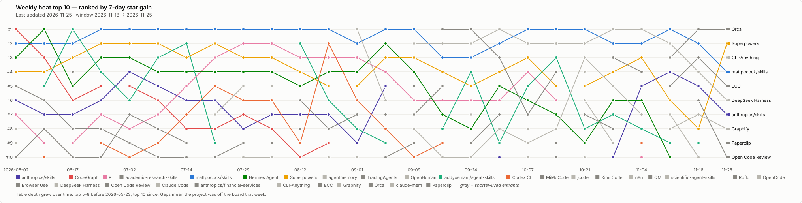
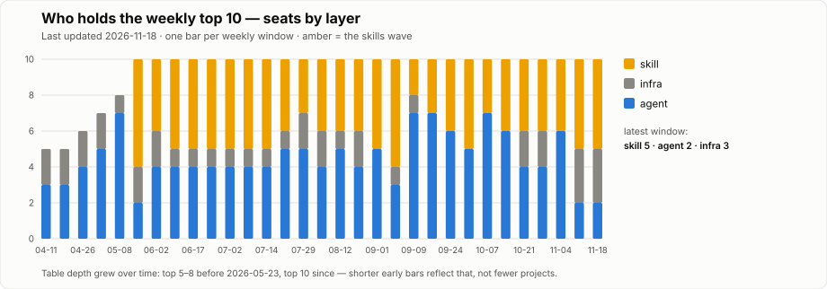
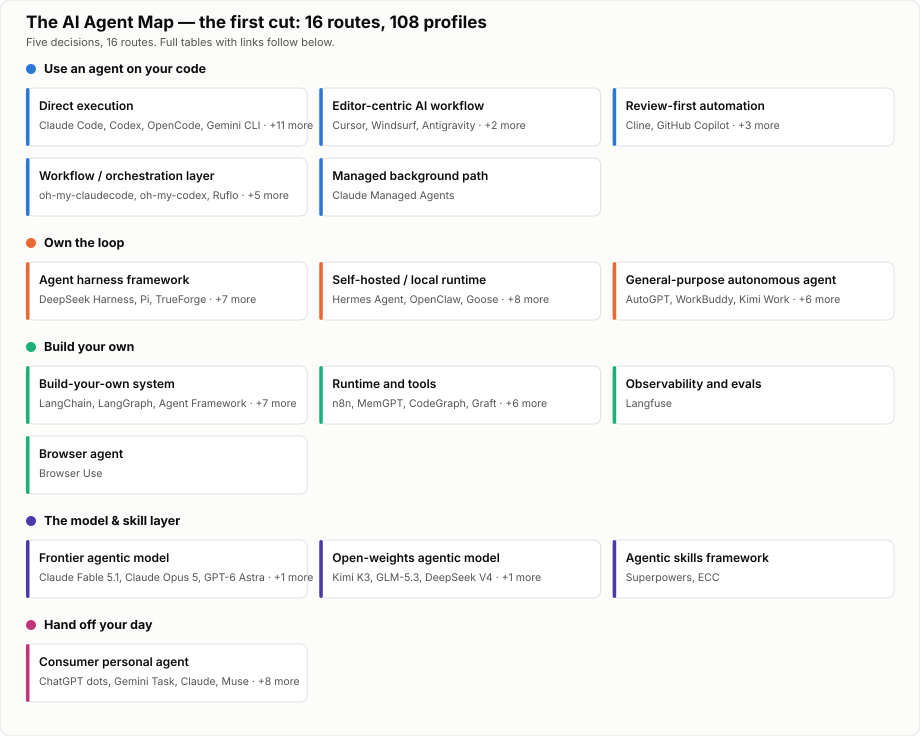

# AI Agent Map

	

AI Agent Map is a practical, visual-first guide for comparing mainstream AI agents, agent platforms, runtimes, and orchestration tools.

The goal is simple: help readers get to a sensible shortlist faster.

## What This Repo Is For

- The agent landscape is crowded.
- Many resources explain ideas, but not fit, anti-fit, or operating cost.
- People usually need a comparison layer, not another pile of links.

This repo stays focused on selection: what a system is good at, where it breaks down, and what kind of operator cost comes with it.

## Where To Start

| If your question is... | Start here |
| --- | --- |
| I need a shortlist first |  |
| I need help choosing for coding automation |  |
| I already have candidates and want a side-by-side view |  |
| I care about dimensions like approval, memory, scheduling, and deployment |  |
| I want every project scored on those dimensions, side by side |  |
| I want to know how capable each model tier is and how agents bill |   |
| My agents already run — I need to know whether they still work |  |
| I want the stock rankings and the weekly trend chart |  |
| I want problem-first guides or the full comparison list |   |

## Recent Heat Ranking

Popularity is not fit.

This table tracks projects that showed up as especially hot in the latest weekly GitHub snapshot. The rank follows the 7-day gain. The total star counts below were checked when this repo was updated.

> **Last updated:** 2026-11-18 · **Snapshot window:** 2026-11-11 → 2026-11-18 (gain since last update: **7 calendar days**, about 7.07 by fetch time against about 7.17 last window, so comparisons below use elapsed time) · **Star counts:** checked at update time

Project names link to the upstream GitHub repo. When this map has a written profile, it is linked separately in the "Map status" column.

| Rank | Project | Current stars | Snapshot gain | Map status | How to read it |
| --- | --- | --- | --- | --- | --- |
| #1&nbsp;(↑) | [Orca](https://github.com/stablyai/orca) | 128.3k | +6,528 | In scope · [profile](agents/orca.md) | **#1 for the first time**, in its second measured window: flat on elapsed time (−7%, about 6,460 a week) while everything that was above it slowed more. It is the second infra repo ever to take #1, after [CodeGraph](agents/codegraph.md) on 06-02. **Past 125k** (128,275). Five desktop releases, `v1.4.257`–`v1.4.262`, plus Android builds |
| #2&nbsp;(↓) | [mattpocock/skills](https://github.com/mattpocock/skills) | 327.0k | +5,791 | Watchlist (Skills Wave) | Down **39%** on elapsed time to about 5,731 a week, giving back last window's rise, and loses #1 after one window. Its lead over [Superpowers](agents/superpowers.md) still grew, to **7,422** (327,036 against 319,614). **Past 325k**. Two commits, no release |
| #3&nbsp;(↑) | [ECC](https://github.com/affaan-m/ECC) | 305.9k | +4,972 | In scope · [profile](agents/ecc.md) | Up **16%** on elapsed time to about 4,920 a week, in its second measured window, so the first that can be compared. **Past 305k** (305,913). No release since `v2.2.3` (Oct 1); hook-validator and CI commits |
| #4&nbsp;(↓) | [DeepSeek Harness](https://github.com/deepseek-ai/deepseek-harness) | 283.3k | +4,854 | In scope · [profile](agents/deepseek-harness.md) | Down **31%** on elapsed time to about 4,803 a week, its smallest 7-day gain since 10-14. **#4 is its lowest seat** in 11 straight windows on the board; every earlier one was #1 or #2. **Past 280k** (283,319). Three pre-releases, `dsh-v0.2.2-rc.2`–`rc.4` |
| #5&nbsp;(↓) | [anthropics/skills](https://github.com/anthropics/skills) | 196.9k | +4,315 | Watchlist (Skills Wave) | Down 20% on elapsed time after two straight rises. **Past 195k** (196,939). Two commits updating the `docx`, `pdf`, `pptx` and `xlsx` skills; no release |
| #6&nbsp;(new) | [Open Code Review](https://github.com/alibaba/open-code-review) | 54.0k | +4,202 | In scope · [profile](agents/open-code-review.md) | **Back after four windows off the board**, up **866%** on elapsed time (+4,202 against +441), its largest gain since 09-24. Nothing in the window explains it: five patch releases (`v1.13.8`–`v1.13.12`) and routine commits, so by this board's rule it is a spike until it holds a second window. **Past 50k** (54,018) |
| #7&nbsp;(↑) | [Graphify](https://github.com/Graphify-Labs/graphify) | 149.8k | +4,049 | In scope · [profile](agents/graphify.md) | Flat on elapsed time (+6%) in its second measured window. **159 short of 150k** (149,841). Six releases, `v0.9.107`–`v0.9.112` |
| #8&nbsp;(↓) | [Superpowers](https://github.com/obra/superpowers) | 319.6k | +3,726 | In scope · [profile](agents/superpowers.md) | Flat on elapsed time (−5%, about 3,687 a week) after last window's 29% drop. **7,422 behind** mattpocock/skills. No release and no commit since Nov 3 |
| #9&nbsp;(=) | [addyosmani/agent-skills](https://github.com/addyosmani/agent-skills) | 118.8k | +3,380 | Watchlist (Skills Wave) | Up **48%** on elapsed time, a second straight rise. **Past 118k** (118,765). Plugin release `0.6.16` (Nov 14) |
| #10&nbsp;(↓) | [claude-mem](https://github.com/thedotmack/claude-mem) | 118.1k | +2,147 | In scope · [profile](agents/claude-mem.md) | Down **44%** on elapsed time in its second measured window; holds the last seat by 346 over [Hermes Agent](agents/hermes-agent.md). **Past 118k** (118,091). Eleven releases, `v15.17.1`–`v16.0.0` |

- Heat is useful for discovery, not for selection by itself.
- **Window length.** Fetches were about **7.07 days** apart (Nov 11 15:20 → Nov 18 17:06, Beijing time) against about **7.17** last window. The 1% gap is well under the 5% at which this board must switch basis, but the last three windows were read on elapsed time, so this one is too. The table shows raw gains; single-digit changes count as flat.
- **The board cooled.** Of the 60 repos measured in both windows, **23 accelerated and 37 slowed** on elapsed time (also 23 and 37 on raw gains). This is the first window in which last edition's five new pickups have an earlier rate, so the count now includes them. The ten seats ran about 43,505 a week against about 48,831 (−11%), and the bar for #10 fell about 3% (about 2,195 → about 2,125 a week). Of the nine seat-holders that were on the board last window, two sped up ([ECC](agents/ecc.md), addyosmani/agent-skills), three were flat ([Orca](agents/orca.md), [Graphify](agents/graphify.md), [Superpowers](agents/superpowers.md)) and four slowed (mattpocock/skills, [DeepSeek Harness](agents/deepseek-harness.md), anthropics/skills, [claude-mem](agents/claude-mem.md)).
- **[Orca](agents/orca.md) took #1 by holding still.** It was flat (−7%) while mattpocock/skills fell 39% and DeepSeek Harness 31%. It is the second infra repo to take #1 in 31 windows, after [CodeGraph](agents/codegraph.md) on 06-02. This is only its second measured window, so the board has one comparison for it, not a trend. mattpocock/skills held #1 for one window only, but widened its lead over Superpowers to **7,422**; in gains it trailed the other four general collections combined by 10,602 (5,791 against 4,972 + 4,315 + 3,726 + 3,380 = 16,393).
- **The second measurement of last edition's pickups split.** [ECC](agents/ecc.md) sped up 16%; Orca and [Graphify](agents/graphify.md) were flat; [claude-mem](agents/claude-mem.md) fell 44% and [Paperclip](agents/paperclip.md) 22% (13th). Two windows are not enough to call any of them a lasting rate.
- **[Hermes Agent](agents/hermes-agent.md)'s run ended at 30 windows.** It had been in the top ten in every window this map has recorded; this time it is 11th (+1,801, down 19%), 346 behind claude-mem, with `v0.23.2` and daily canary builds. [Superpowers](agents/superpowers.md) and mattpocock/skills (26 each) are now the longest runs still going; DeepSeek Harness (11) and addyosmani/agent-skills (10) come next. DeepSeek Harness's #4 is its lowest seat since it was first tracked: every earlier window it was #1 or #2.
- **A new spike.** [Open Code Review](agents/open-code-review.md) came back after four windows off the board, up **866%** on elapsed time to #6 (+4,202 against +441) and past 50k. The window shows only five patch releases and routine commits, so by this board's rule it is a spike until it holds a second window. Off the board, [Qwen Code](agents/qwen-code.md) rose 370% to 14th and passed 30k, alongside `v0.27.3`–`v0.28.0`, a `v1.0.0-preview.1` and desktop builds.
- **The mix held.** Skills hold **five seats** (#2, #3, #5, #8, #9), all general collections, for a second straight window. Infra holds **three** (Orca, Graphify, claude-mem), tying last window's record. Agents hold **two** (#4, #6), tying the fewest for a second straight window.
- **The model layer: two new tiers, and one default change still in pre-release.** (1) **OpenAI released GPT-6.2 Astra and GPT-6.2 Sol** (Nov 17) in the API, ChatGPT Work and Codex: Astra "for demanding reasoning and coding tasks", Sol "for everyday coding and agent workflows". OpenAI's changelog gives no benchmark figure this map can record. GitHub Copilot added both the same day. In [Codex CLI](agents/codex.md), PR 62106 (merged Nov 17) makes GPT-6.2 Sol "the default catalog selection", but it is only in the `rust-v0.171.0-alpha.13` pre-release; stable `0.170.0` does not include it, so this map does not count it as a shipped default change yet. (2) **Google released Gemini 4 Hydrogen** (Nov 12, `gemini-4-hydrogen`) on the Gemini API free and paid tiers, with a fourth `xhigh` thinking level. Google reports 57% on Terminal-Bench 4.1. In [Antigravity](agents/antigravity.md) it is on paid Pro, Ultra and Enterprise, and pairs with Carbon or Argon in the new Orchestrator option; Copilot added it on Nov 13. (3) **Copilot retired models**: Claude Opus 4.8, Claude Opus 5 and GPT-5.6 Terra on Nov 16, with Fable 5, Gemini 4 Argon, Gemini 3.8 Flash and others to follow on Dec 14. No tracked coding agent changed a default in a stable release this window: [Claude Code](agents/claude-code.md) (four releases) did not, and [Gemini CLI](agents/gemini-cli.md)'s source default on main is still `gemini-2.5-pro`, which Google routes to `gemini-3.8-flash` on Dec 1. Details in [market-events](market-events.md).
- **Microsoft Agent Framework's repository is gone from GitHub.** At this fetch `microsoft/agent-framework` returned 404 on both the API and the web page; it is not a redirect, and this map found no announcement. The `agent-framework` package on PyPI (`1.26.0`, Nov 12) still links to it, and the docs at learn.microsoft.com/agent-framework still load. It has no gain this window and is out of tracking until the repo returns or a new home is confirmed; the [profile](agents/microsoft-agent-framework.md) carries a dated note.
- **Two new profiles.** [DeerFlow](agents/deer-flow.md) (85.5k, MIT), ByteDance's self-hosted "super agent harness", files under general-purpose autonomous agents; [nanobot](agents/nanobot.md) (50.2k, MIT), a small-core self-hosted personal agent, files under self-hosted runtimes. Both enter star tracking next refresh. The scan also found [janestreet/agent_skills](https://github.com/janestreet/agent_skills) (10.0k, created Nov 3), a skills collection, which goes on the watchlist.
- Milestones, checked against the raw counts rather than the rounded column: **mattpocock/skills 325k**, **ECC 305k**, DeepSeek Harness **280k**, anthropics/skills **195k**, [Codex CLI](agents/codex.md) **135k**, Orca **125k**, [CrewAI](agents/crewai.md) **61k**, [CLI-Anything](agents/cli-anything.md) **59k**, both research collections **57k**, Open Code Review **50k**, [LangGraph](agents/langgraph.md) **45k**, Qwen Code **30k** and [TrueForge](agents/trueforge.md) **6.5k**. Near misses: [Ruflo](agents/ruflo.md) is **1 short of 82k**, [CodeGraph](agents/codegraph.md) 76 short of 78k, Graphify 159 short of 150k and [LangChain](agents/langchain.md) 164 short of 150k.
- [OpenClaw](agents/openclaw.md) remains the absolute leader at 394.7k stars (+390, down 11% on elapsed time); it is profiled but stays out of the gain-ranked table because reliable week-over-week deltas for a project this large are noisy.

More window notes: skills-wave share, OpenClaw, and everything growing outside the top 10

- The `.claude/skills` wave **holds five of the top ten**: #2, #3, #5, #8 and #9, all general collections, for a second straight window. Policy unchanged: curated collections are tracked as Skills Wave entries and compared on the [Agent Skills](comparisons/agent-skills.md) page; the framework end is profiled through [Superpowers](agents/superpowers.md) and [ECC](agents/ecc.md).
- Just off the table, on elapsed time: [Hermes Agent](agents/hermes-agent.md) 264.3k (+1,801) at 11th, down 19%, its first window off the board; [OpenCode](agents/opencode.md) 227.7k (+1,729) at 12th, up 11%, on `v2.3.0`–`v2.3.2`; [Paperclip](agents/paperclip.md) 114.7k (+1,657) at 13th, down 22%; [Qwen Code](agents/qwen-code.md) 30.7k (+1,448) at 14th, up 370%; [Pi](agents/pi.md) 122.6k (+1,310) at 15th, flat (−9%); TradingAgents 123.0k (+1,105) at 16th, down 27%; academic-research-skills 57.4k (+998) at 17th, down 13%; [Codex CLI](agents/codex.md) 135.7k (+912) at 18th, down 48%; scientific-agent-skills 57.6k (+872) at 19th, up 14%; and [Claude Code](agents/claude-code.md) 156.1k (+865) at 20th, up 11%, on four releases (`v2.1.323`, `v2.1.325`, `v2.1.326`, `v2.1.327`). OpenClaw is excluded from the board, so these off-board positions are counted the same way.
- **The research collections converged again.** scientific-agent-skills sped up 14% and academic-research-skills slowed 13%, but K-Dense's lead fell from 369 to 243 (57,640 against 57,397). [mini-swe-agent](agents/mini-swe-agent.md) gave back most of last window's jump (+201, down 56%). [Gemini CLI](agents/gemini-cli.md) more than doubled from a low base (+144, up 147%, 40th). [anthropics/financial-services](https://github.com/anthropics/financial-services) slowed 14% (+160, 38th).
- Continuing to grow but outside the top 10 by gain (raw figures, 7 calendar days): [Hermes Agent](agents/hermes-agent.md) 264.3k (+1,801), [OpenCode](agents/opencode.md) 227.7k (+1,729), [Paperclip](agents/paperclip.md) 114.7k (+1,657), [Qwen Code](agents/qwen-code.md) 30.7k (+1,448), [Pi](agents/pi.md) 122.6k (+1,310), [TradingAgents](https://github.com/TauricResearch/TradingAgents) 123.0k (+1,105), [academic-research-skills](https://github.com/Imbad0202/academic-research-skills) 57.4k (+998), [Codex CLI](agents/codex.md) 135.7k (+912), [scientific-agent-skills](https://github.com/K-Dense-AI/scientific-agent-skills) 57.6k (+872), [Claude Code](agents/claude-code.md) 156.1k (+865), [n8n](agents/n8n.md) 210.8k (+725), [Browser Use](agents/browser-use.md) 121.4k (+724), [CLI-Anything](agents/cli-anything.md) 59.3k (+697), [CodeGraph](agents/codegraph.md) 77.9k (+571), [Ruflo](agents/ruflo.md) 82.0k (+546), [OpenHands](agents/openhands.md) 93.7k (+540), [LangChain](agents/langchain.md) 149.8k (+496), [LiteLLM](agents/litellm.md) 63.5k (+389), [LangGraph](agents/langgraph.md) 45.1k (+321), [CrewAI](agents/crewai.md) 61.1k (+306), [Langfuse](agents/langfuse.md) 37.6k (+305), [Goose](agents/goose.md) 56.7k (+301), [Cline](agents/cline.md) 71.7k (+225), [mini-swe-agent](agents/mini-swe-agent.md) 9.7k (+201), [12-factor-agents](https://github.com/humanlayer/12-factor-agents) 27.3k (+195), [jcode](agents/jcode.md) 21.9k (+185), [agentmemory](https://github.com/rohitg00/agentmemory) 30.4k (+162), [anthropics/financial-services](https://github.com/anthropics/financial-services) 41.4k (+160), [ZCode](agents/zcode.md) 8.8k (+150), [Gemini CLI](agents/gemini-cli.md) 108.9k (+144), [Trail Code (Graft)](agents/graft.md) 11.3k (+133), [eve](agents/eve.md) 6.0k (+107), [Aider](agents/aider.md) 50.2k (+101), [OpenHuman](agents/openhuman.md) 42.7k (+98), [AutoGPT](agents/autogpt.md) 188.1k (+92), [Omnigent](agents/omnigent.md) 11.4k (+83), [LlamaIndex](agents/llamaindex.md) 52.9k (+65), [Letta (MemGPT)](agents/memgpt.md) 25.5k (+65), [Grok Build](agents/grok-build.md) 27.8k (+58), [QM](agents/qm.md) 15.7k (+53), [Continue](agents/continue.md) 36.5k (+52), [Kimi Code](agents/kimi-code.md) 8.2k (+51), [SWE-agent](agents/swe-agent.md) 20.8k (+47), [Open Interpreter](agents/open-interpreter.md) 68.9k (+45), [TrueForge](agents/trueforge.md) 6.5k (+34), [OpenHarness](agents/openharness.md) 16.2k (+30), [MiMoCode](agents/mimocode.md) 13.8k (+9), [Flowise](agents/flowise.md) 55.6k (+8), [CodeWhale](agents/codewhale.md) 41.2k (+6), [CoStrict](agents/costrict.md) 4.5k (+1)

### Ranking Trend

How the weekly top 10 has shifted since tracking began — each line is one project, breaks mean it fell off the board that week:

  

And the same windows read as seats per layer — the quantitative version of the skills-wave story the bullets tell in prose:

  

Full stock rankings by category — agents, agent infra, skills, and their verticals, sorted by total stars — live in [rankings/](rankings/README.md).

## Beyond The Rank

Popularity tells you what to look at. These six pages tell you what to pick:

- **[Capability matrix](capabilities/matrix.md)** — every project scored side by side (●/◐/○/—) across the nine shared [capability dimensions](capabilities/README.md), grouped by route. The answer to "for this capability, who treats it as a core strength."
- **[Benchmarks & billing](comparisons/benchmarks-and-billing.md)** — frontier-model capability, plus how each coding agent bills. Since the model layer went tiered and metered, "which tier for this task" is the selection decision. This map does not list or compare prices.
- **[Memory approaches](comparisons/memory-approaches.md)** — seven different things projects mean by "has memory," from self-editing stores to passive semantic recall, and which to pick for what you need to persist.
- **[Consumer personal agents](comparisons/personal-agents.md)** — the agents you hand your day to — ChatGPT dots, Gemini Task, Claude, Muse, Grok Bot, Cue, Doubao, Qwen, AutoGLM, Yuanbao, Today — compared on facts and control rather than popularity, because closed products have no public number to rank by.
- **[Agent Skills](comparisons/agent-skills.md)** — what a skill is, which agents load one, and the five largest collections and frameworks (mattpocock/skills, Superpowers, ECC, anthropics/skills, addyosmani/agent-skills) compared on kind, footprint, maintainer and license, plus what to check before installing someone else's. Collections are compared here rather than profiled.
- **[Observability & evaluation](comparisons/observability-and-evals.md)** — the layer under everything above: once an agent runs unattended, failure stops looking like a crash and starts looking like silent quality drift. Compares [Langfuse](agents/langfuse.md), Opik, Phoenix, Helicone, LangSmith and others — and untangles the four different things "open source" means in that field.

## Market Pulse

The three structural stories shaping selection right now — full records with dates and sources live in [market-events.md](market-events.md):

- **The `.claude/skills` wave takes five seats, and mattpocock/skills passes Superpowers** (May 2026 → ongoing): curated skill collections and skills frameworks have held between two and six of the weekly heat top 10 for five months, and the count rotates rather than sitting still: 6/10, then 2/10, 3/10, 4/10, 5/10, 3/10, 4/10 for four windows, and now **5 of 10** (2026-11-11), the first time all five are general collections: [mattpocock/skills](https://github.com/mattpocock/skills), [anthropics/skills](https://github.com/anthropics/skills), [ECC](agents/ecc.md), [Superpowers](agents/superpowers.md) and [addyosmani/agent-skills](https://github.com/addyosmani/agent-skills). ECC counts for the first time, on its first measured gain. mattpocock (321,245) now leads Superpowers (315,888) by 5,357, so the largest collection this map tracks is a personal directory, the key-person risk this map has flagged since June; in gains it still trailed the other four combined by 6,439. ECC (300,941) is third. This map profiles the framework end through Superpowers and ECC, and compares collections on the [Agent Skills](comparisons/agent-skills.md) page.
- **The model ladder now has every rung filled at both vendors, and Google has a new top**: [Claude Fable 5.2](agents/claude-fable-5.md) (Nov 9), [GPT-6 Astra](agents/gpt-6-astra.md) (Sept 3) and Google's **Gemini 4 Carbon** (announced Oct 28, on the Gemini API Nov 10) sit at the top; below them are **Opus 5.5** (Sept 22), the two mid tiers **Sonnet 5.5** and **GPT-6.1 Sol** (Sept 28–29, both their vendor's coding-agent default), and the lowest tiers, **GPT-6 Luna** (Sept 22) and **Claude Haiku 5.5** (Oct 7). On **Oct 26** OpenAI added **GPT-6.1 Terra**, selectable in Codex but not made a default. Google's **Gemini 4 Argon** opened to the paid API on **Oct 13**, and Meta released **Muse Wonder** on Oct 12. On the open side, **Kimi K3.1 Pro**'s weights went public by Nov 5. See [benchmarks & billing](comparisons/benchmarks-and-billing.md).
- **Product boundaries are collapsing upward**: OpenAI merged Codex into the ChatGPT app (July 9), and at DevDay (Sept 29) moved it further off the laptop with reusable cloud environments usable from any device — on the OpenAI side, "which coding agent" keeps turning into "how you use ChatGPT." The bundled default model changed twice in a month: [GPT-6 Astra](agents/gpt-6-astra.md) from `rust-v0.153.4` (Sept 4), then **GPT-6.1 Sol** from `rust-v0.159.1` (Sept 29), carried to the main release line by `rust-v0.161.0` (Oct 7). Since `0.162.0` (Oct 8) the TUI also follows the server's model default, so the effective default can change without a release, and on **Oct 14** OpenAI retired GPT-5.5 from Codex and ChatGPT for ChatGPT sign-in. The run of windows with no tracked coding agent changing a default in a release ended at five on Nov 9, though not at Codex: [Claude Code](agents/claude-code.md) moved its Fable default to 5.2 and [Pi](agents/pi.md) its `anthropic` provider default to Opus 5.5, while Codex's main default has been GPT-6.1 Sol since Sept 29. If you run Codex on defaults, pin the model id anyway — and know that a pinned model can be retired under you; the product will not hold either still for you. See [Codex](agents/codex.md).

## The First Cut Of The Map

  

| Route | Representative projects | Typical user |
| --- | --- | --- |
| Direct execution | [Claude Code](agents/claude-code.md), [Aider](agents/aider.md), [Codex](agents/codex.md), [Kimi Code](agents/kimi-code.md), [MiMoCode](agents/mimocode.md), [CodeWhale](agents/codewhale.md), [ZCode](agents/zcode.md), [CodeBuddy](agents/codebuddy.md), [OpenCode](agents/opencode.md), [Gemini CLI](agents/gemini-cli.md), [Qwen Code](agents/qwen-code.md), [Grok Build](agents/grok-build.md), [Devin](agents/devin.md), [Jules](agents/jules.md) | Someone who wants to hand a concrete coding task to an agent (see the [terminal coding CLI comparison](comparisons/coding-cli-agents.md)) |
| Agent harness framework | [DeepSeek Harness](agents/deepseek-harness.md), [Pi](agents/pi.md), [jcode](agents/jcode.md), [OpenHands](agents/openhands.md), [SWE-agent](agents/swe-agent.md), [mini-swe-agent](agents/mini-swe-agent.md), [OpenHarness](agents/openharness.md), [QM](agents/qm.md), [Omnigent](agents/omnigent.md), [TrueForge](agents/trueforge.md) | Someone who wants to own the agent loop, tool surface, and permissions instead of inheriting a vendor's product — QM and Omnigent extend this to running *several* harnesses under one layer (see the [harness comparison](comparisons/agent-harness-frameworks.md)) |
| Frontier agentic model | [Claude Fable 5.2](agents/claude-fable-5.md), [Claude Opus 5](agents/claude-opus-5.md), [GPT-6 Astra](agents/gpt-6-astra.md), [GPT-5.5](agents/gpt-5.5.md) | Someone choosing which model to wire into their own agent system or evaluating the capability ceiling of Anthropic / OpenAI surfaces — the ceilings (Fable 5.2, Astra) and the tier you actually run under them are separate decisions (Opus 5 was Claude Code's default Opus until Opus 5.5 replaced it on Sept 22, and Sonnet 5.5 became the default Sonnet on Sept 28) |
| Open-weights agentic model | [Kimi K3](agents/kimi-k3.md), [GLM-5.3](agents/glm-5.md), [DeepSeek V4](agents/deepseek-v4.md), [Qwen3-Coder](agents/qwen3-coder.md) | Someone who wants frontier-class capability on weights they host and licence themselves — a different decision from picking between the closed ceilings |
| Agentic skills framework | [Superpowers](agents/superpowers.md), [ECC](agents/ecc.md) | Someone who wants a methodology + composable skills layer that plugs into Claude Code, Codex, Cursor, and similar agents |
| Workflow / orchestration layer | [oh-my-claudecode](agents/oh-my-claudecode.md), [oh-my-codex](agents/oh-my-codex.md), [Ruflo](agents/ruflo.md), [Orca](agents/orca.md), [Paperclip](agents/paperclip.md) | Someone who already likes Claude Code or Codex and wants stronger orchestration on top (Ruflo extends this to multi-machine federation and 100+ specialized agents); Orca and Paperclip coordinate many different agents at once |
| Editor-centric AI workflow | [Cursor](agents/cursor.md), [Windsurf](agents/windsurf.md), [Google Antigravity](agents/antigravity.md), [TRAE](agents/trae.md), [Continue](agents/continue.md) | Someone who wants the editor itself to stay central |
| Review-first automation | [Cline](agents/cline.md), [GitHub Copilot](agents/github-copilot.md), [Froge Code](agents/froge-code.md), [CoStrict](agents/costrict.md), [Open Code Review](agents/open-code-review.md) | Someone who wants review and human control to stay central (CoStrict adds enterprise strict-workflow + private deployment; Open Code Review is review only, tuned for precision in CI) |
| Managed background path | [Claude Managed Agents](agents/claude-managed-agents.md) | Someone who needs scheduled, cloud, or detached Anthropic workflows |
| Consumer personal agent | [ChatGPT dots](agents/chatgpt-dots.md), [Gemini Task](agents/gemini-task.md), [Claude (Cowork)](agents/claude-cowork.md), [Claude Duet](agents/claude-duet.md), [Muse (Meta)](agents/meta-muse.md), [Grok Bot](agents/grok-bot.md), [Cue (Manus)](agents/manus-cue.md), [Doubao](agents/doubao.md), [Qwen app](agents/qwen-app.md), [AutoGLM](agents/autoglm.md), [Yuanbao](agents/yuanbao.md), [Today](agents/today-ai.md) | Someone who wants to hand errands, inboxes, bookings or their phone to an agent sold as a product rather than run as software (see the [personal agents comparison](comparisons/personal-agents.md)) |
| General-purpose autonomous agent | [AutoGPT](agents/autogpt.md), [Agent Zero](agents/agent-zero.md), [BabyAGI](agents/babyagi.md), [Julep](agents/julep.md), [GenericAgent](agents/generic-agent.md), [ml-intern](agents/ml-intern.md), [WorkBuddy](agents/workbuddy.md), [Kimi Work](agents/kimi-work.md), [DeerFlow](agents/deer-flow.md) | Someone who wants autonomous, general-purpose task execution — ml-intern is the ML-specialized variant, while WorkBuddy and Kimi Work aim the same loop at desktop knowledge work rather than repositories |
| Build-your-own system | [LangChain](agents/langchain.md), [LangGraph](agents/langgraph.md), [CrewAI](agents/crewai.md), [LlamaIndex](agents/llamaindex.md), [Haystack](agents/haystack.md), [Semantic Kernel](agents/semantic-kernel.md), [DSPy](agents/dspy.md), [Pydantic AI](agents/pydantic-ai.md), [eve](agents/eve.md), [Microsoft Agent Framework](agents/microsoft-agent-framework.md) | Teams building their own agent platform instead of buying one |
| Runtime and tools | [n8n](agents/n8n.md), [MemGPT](agents/memgpt.md), [Open Interpreter](agents/open-interpreter.md), [LiteLLM](agents/litellm.md), [Flowise](agents/flowise.md), [CodeGraph](agents/codegraph.md), [Trail Code (Graft)](agents/graft.md), [CLI-Anything](agents/cli-anything.md), [claude-mem](agents/claude-mem.md), [Graphify](agents/graphify.md) | Teams that need workflow automation, code execution, LLM gateways, agent context infrastructure, agent-driven CLIs, or visual builders |
| Observability and evals | [Langfuse](agents/langfuse.md) | Someone whose agents already run in production and needs to know what they did, what they cost, and whether quality is drifting (see [observability & evaluation](comparisons/observability-and-evals.md)) |
| Browser agent | [Browser Use](agents/browser-use.md) | Someone whose task lives on a website with no API — a different question from how an agent edits files, because it decides what an agent may do as you on the open web |
| Self-hosted / local runtime | [AI Edge Gallery](agents/ai-edge-gallery.md), [Goose](agents/goose.md), [Hermes Agent](agents/hermes-agent.md), [OpenClaw](agents/openclaw.md), [Mercury Agent](agents/mercury-agent.md), [OpenHuman](agents/openhuman.md), [nanobot](agents/nanobot.md) | Users who need on-device privacy, long-running agents, local control, channels, devices, or personal-data life integration |

## Current Mainstream Coverage

100 profiled projects, grouped by what they are. Expand a group, or browse the full route/coverage tables in [agents/](agents/README.md).

<strong>Coding agents, editors, and orchestration</strong> (36 projects)

| Project | Route | One-line positioning |
| --- | --- | --- |
| [Aider](agents/aider.md) | Direct execution | Terminal-first AI pair programmer close to git |
| [Claude Code](agents/claude-code.md) | Direct execution | Local and IDE-first coding agent |
| [Claude Managed Agents](agents/claude-managed-agents.md) | Managed background path | Anthropic managed / cloud execution mapping |
| [Codex](agents/codex.md) | Direct execution | Coding agent inside the ChatGPT app, with async cloud delegation |
| [oh-my-claudecode](agents/oh-my-claudecode.md) | Workflow layer | Teams-first orchestration layer on top of Claude Code |
| [oh-my-codex](agents/oh-my-codex.md) | Workflow layer | Stronger workflow, teams, and persistent state around Codex CLI |
| [Orca](agents/orca.md) | Workflow / orchestration layer | Open-source desktop app that runs any CLI coding agent side by side, each in its own git worktree, with review, browser, remote servers and a phone companion |
| [Cursor](agents/cursor.md) | Editor-centric platform | AI editor spanning local coding, cloud agents, and integrations |
| [GitHub Copilot](agents/github-copilot.md) | Platform | Multi-surface agent platform across VS Code and GitHub |
| [Cline](agents/cline.md) | Review-first execution | Approval-first editor-native coding agent |
| [Windsurf](agents/windsurf.md) | AI-native IDE | Cascade-centered AI IDE |
| [Google Antigravity](agents/antigravity.md) | Editor-centric AI workflow | Google's agent-first platform: desktop agent app, `agy` CLI, standalone IDE and editor extensions on one Gemini-tuned harness; free weekly tier, closed source |
| [TRAE](agents/trae.md) | Editor-centric AI workflow | ByteDance's AI IDE: VS Code-style IDE with an AI-led SOLO mode, plus an Agent window for parallel, cloud and scheduled tasks; separate international and China editions; chats may train models unless Privacy Mode is on |
| [OpenHands](agents/openhands.md) | Open-source execution | Open-source software engineering agent |
| [Devin](agents/devin.md) | Managed execution | End-to-end managed software engineering execution |
| [Jules](agents/jules.md) | Managed cloud execution | GitHub-connected coding delegation with PR handoff |
| [Continue](agents/continue.md) | Editor-centric | Open-source IDE extension with full model freedom |
| [Froge Code](agents/froge-code.md) | Review-first automation | Provisionally mapped to Automagik Genie |
| [Pi](agents/pi.md) | Agent harness framework | Minimal terminal coding-agent harness with multi-provider LLM support |
| [jcode](agents/jcode.md) | Agent harness framework | Rust multi-session coding harness — fastest boot, provider-neutral OAuth, passive semantic memory |
| [CodeWhale](agents/codewhale.md) | Direct execution | Provider-neutral Rust terminal coding agent, 40+ provider routes, DeepSeek still the default (formerly DeepSeek-TUI) |
| [Kimi Code](agents/kimi-code.md) | Direct execution | Moonshot AI's official Kimi-native terminal coding CLI (successor to kimi-cli) |
| [MiMoCode](agents/mimocode.md) | Direct execution | Xiaomi's official MiMo terminal coding agent with built-in cross-session memory |
| [Grok Build](agents/grok-build.md) | Direct execution | SpaceXAI's official Rust terminal coding agent — full-screen TUI, headless CI mode, ACP editor server |
| [CoStrict](agents/costrict.md) | Review-first automation | Enterprise Cline-lineage coding agent with strict standardized workflow, AI code review, and private deployment |
| [SWE-agent](agents/swe-agent.md) | Agent harness framework | Princeton + Stanford's original SWE-bench harness with single-YAML configuration |
| [mini-swe-agent](agents/mini-swe-agent.md) | Agent harness framework | The ~100-line Python successor to SWE-agent that still scores >74% on SWE-bench Verified |
| [OpenHarness](agents/openharness.md) | Agent harness framework | HKUDS's 10-subsystem open agent harness with 43+ tools, anthropics/skills, and MCP |
| [Omnigent](agents/omnigent.md) | Agent harness framework | Meta-harness that mixes Claude Code, Codex, Cursor, OpenCode, Hermes, and Pi in one session, with policies and cloud sandboxes |
| [OpenCode](agents/opencode.md) | Direct execution | The largest vendor-neutral open-source coding agent — 222k stars (2026-10-28), MIT |
| [Gemini CLI](agents/gemini-cli.md) | Direct execution | Google's open-source terminal agent with Search grounding built in; since 2026-06-18 it serves Code Assist Standard/Enterprise and paid API keys, while consumer users were moved to Antigravity CLI |
| [Qwen Code](agents/qwen-code.md) | Direct execution | Open client and open weights, switchable across OpenAI/Anthropic/Gemini/local at runtime |
| [DeepSeek Harness](agents/deepseek-harness.md) | Agent harness framework | Everything-is-a-plugin harness — even the agent loop is swappable from config |
| [ZCode](agents/zcode.md) | Direct execution | Zhipu's desktop agentic dev environment: long-horizon "Goal" tasks, steerable from WeChat/Feishu/Telegram |
| [CodeBuddy](agents/codebuddy.md) | Direct execution | Tencent Cloud's coding line (editor plugin, CodeBuddy IDE, CodeBuddy Code CLI): a Claude-Code-shaped loop with a multi-vendor model catalog and private-cloud editions |
| [Open Code Review](agents/open-code-review.md) | Review-first automation | Alibaba's precision-first code-review CLI — deterministic pipeline around the model, plus CI and agent-plugin surfaces |

<strong>Autonomous and self-hosted agents</strong> (19 projects)

| Project | Route | One-line positioning |
| --- | --- | --- |
| [AI Edge Gallery](agents/ai-edge-gallery.md) | On-device local runtime | Mobile-first local assistant sandbox with agent skills |
| [Goose](agents/goose.md) | Open-source local platform | Extensible local agent across desktop, CLI, and API |
| [Hermes Agent](agents/hermes-agent.md) | Multi-agent / self-hosted | Long-lived self-hosted environment with memory and skills |
| [OpenClaw](agents/openclaw.md) | Runtime | Local-first multi-channel runtime layer |
| [AutoGPT](agents/autogpt.md) | Autonomous agent platform | Visual agent builder with workflows, marketplace, and multi-model support |
| [Agent Zero](agents/agent-zero.md) | Autonomous agent | Self-building autonomous agent with dynamic tool creation |
| [BabyAGI](agents/babyagi.md) | Experimental | Pioneering autonomous agent experiment — educational, not production |
| [Open Interpreter](agents/open-interpreter.md) | Runtime | Natural language to local code execution, no sandbox |
| [Mercury Agent](agents/mercury-agent.md) | Self-hosted multi-channel | Permission-hardened agent for CLI and Telegram with token budgets |
| [ml-intern](agents/ml-intern.md) | Domain-specific autonomous agent | Hugging Face's autonomous ML engineer — research, code, and ship ML using HF tooling |
| [GenericAgent](agents/generic-agent.md) | Self-evolving autonomous agent | Small-seed agent that grows a personal skill tree on every task |
| [OpenHuman](agents/openhuman.md) | Self-hosted / local runtime | Desktop life-integration agent with 118+ connectors, local Memory Tree, and Ollama support |
| [Julep](agents/julep.md) | Workflow engine | Temporal-backed durable workflow engine for stateful AI agents |
| [QM](agents/qm.md) | Agent harness framework | Y Combinator's multiplayer agent for Slack and web — per-person and per-room scopes, self-hosted, harness-agnostic |
| [WorkBuddy](agents/workbuddy.md) | General-purpose autonomous agent | Tencent's desktop office agent — the same loop, aimed at documents, decks, and spreadsheets |
| [Kimi Work](agents/kimi-work.md) | General-purpose autonomous agent | Moonshot's desktop knowledge-work agent: mounted folders, browser automation, built-in cron |
| [TrueForge](agents/trueforge.md) | Agent harness framework | Harness-as-a-server — one loop behind an HTTP API, with a chat UI, a TypeScript SDK, and an embeddable UI |
| [DeerFlow](agents/deer-flow.md) | General-purpose autonomous agent | ByteDance's self-hosted "super agent harness": a lead agent with sub-agents, long-term memory, sandboxed execution, chat-app channels and schedules |
| [nanobot](agents/nanobot.md) | Self-hosted / local runtime | Small-core self-hosted personal agent: one gateway behind a WebUI, TUI and 18 chat channels, with Dream memory and cron automations |

<strong>Frameworks and infrastructure</strong> (23 projects)

| Project | Route | One-line positioning |
| --- | --- | --- |
| [eve](agents/eve.md) | Build-your-own platform | Vercel's filesystem-first agent framework — durable execution, sandboxes, approvals, channels, evals |
| [LangChain](agents/langchain.md) | Platform | High-level framework for building custom agents quickly |
| [LangGraph](agents/langgraph.md) | Platform | Low-level framework for durable stateful workflows |
| [CrewAI](agents/crewai.md) | Multi-agent framework | Role-based agent collaboration with fast prototyping |
| [LlamaIndex](agents/llamaindex.md) | Data-first framework | RAG and agentic applications over documents and data |
| [n8n](agents/n8n.md) | Workflow automation | Visual workflow platform with native AI agent nodes and 400+ integrations |
| [MemGPT](agents/memgpt.md) | Stateful agent platform | Persistent memory agents that learn across sessions (now Letta) |
| [Haystack](agents/haystack.md) | Framework | Production-oriented RAG and agent framework by deepset |
| [Semantic Kernel](agents/semantic-kernel.md) | Framework | Microsoft's AI orchestration SDK for .NET, Python, and Java |
| [DSPy](agents/dspy.md) | Framework | Programmatic prompt optimization — programming, not prompting, LMs |
| [LiteLLM](agents/litellm.md) | Infrastructure | Unified API gateway for 100+ LLM providers |
| [Langfuse](agents/langfuse.md) | Infrastructure | Open-source agent observability, evals, and prompt management (watches agents, does not run them) |
| [Pydantic AI](agents/pydantic-ai.md) | Framework | Type-safe Python agent framework with structured outputs |
| [Flowise](agents/flowise.md) | Visual builder | Drag-and-drop LLM app and agent builder on top of LangChain |
| [Ruflo](agents/ruflo.md) | Workflow / orchestration layer | Multi-agent orchestration platform for Claude with federation across machines, neural memory, and 100+ specialized agents |
| [Paperclip](agents/paperclip.md) | Workflow / orchestration layer | Self-hosted control plane that runs a team of agents like a company: goal-linked tickets, org chart, budgets, approvals and scheduled routines |
| [CodeGraph](agents/codegraph.md) | Runtime and tools | Pre-indexed code knowledge graph + MCP server for Claude Code, Cursor, Codex CLI, opencode, and Hermes Agent |
| [Trail Code (Graft)](agents/graft.md) | Runtime and tools | Code context written as linked markdown in your repo, wired into eight-plus agents with one command |
| [claude-mem](agents/claude-mem.md) | Runtime and tools | Bolt-on cross-session memory: hooks capture agent activity, a model compresses it, relevant context is injected next session; paid hosted observer optional |
| [Graphify](agents/graphify.md) | Runtime and tools | Turns a codebase plus its docs, PDFs and media into a provenance-tagged knowledge graph that agents query through a skill, CLI or local MCP server |
| [Browser Use](agents/browser-use.md) | Browser agent | Gives an agent a real browser — opens pages, clicks, types, fills forms |
| [Microsoft Agent Framework](agents/microsoft-agent-framework.md) | Build-your-own system | AutoGen's successor; production multi-agent workflows across Python, .NET, and Go |
| [CLI-Anything](agents/cli-anything.md) | Runtime and tools | Auto-generates Click-based CLIs for arbitrary software so agents can drive non-API apps |

<strong>Models and skills</strong> (10 entries)

| Project | Route | One-line positioning |
| --- | --- | --- |
| [Claude Fable 5.2](agents/claude-fable-5.md) | Frontier agentic model | Anthropic's Mythos-class ceiling — the model you spend credits on, refreshed Nov 9 2026 |
| [Claude Opus 5](agents/claude-opus-5.md) | Frontier agentic model | The Opus tier below Fable; Claude Code's default Opus until Opus 5.5 replaced it on Sept 22 (Sonnet 5.5 became the default Sonnet on Sept 28) |
| [GPT-6 Astra](agents/gpt-6-astra.md) | Frontier agentic model | OpenAI's current ceiling (Sept 3 2026), shipped to the public in a restricted version |
| [GPT-5.5](agents/gpt-5.5.md) | Frontier agentic model | OpenAI's spring 2026 model, kept as the lineage reference through GPT-5.6 to Astra |
| [Kimi K3](agents/kimi-k3.md) | Open-weights agentic model | First open 3T-class model — 2.8T params, native vision, 1M context, custom licence |
| [GLM-5.3](agents/glm-5.md) | Open-weights agentic model | Strongest open-weights coding model on vendor numbers, Apache-2.0 — and ungated cyber capability |
| [DeepSeek V4](agents/deepseek-v4.md) | Open-weights agentic model | MIT at 1.6T params; SWE-bench Verified 80.6, reproducible because the weights are open |
| [Qwen3-Coder](agents/qwen3-coder.md) | Open-weights agentic model | The one that fits — ~3B activated of 80B, 256K→1M context, runs where you are |
| [Superpowers](agents/superpowers.md) | Agentic skills framework | Methodology and composable skills layer that plugs into Claude Code, Codex, Cursor, and other agents |
| [ECC](agents/ecc.md) | Agentic skills framework | Cross-harness plugin bundling 327 skills, 72 subagents, enforcement hooks, a memory vault and the AgentShield config scanner; Claude Code first |

<strong>Consumer personal agents</strong> (12 products)

| Project | Route | One-line positioning |
| --- | --- | --- |
| [ChatGPT dots](agents/chatgpt-dots.md) | Consumer personal agent | OpenAI's always-on agent in ChatGPT — GPT-6 Astra, its own cloud computer, reachable in Slack, Teams and by call; Pro only, not in Europe |
| [Gemini Task](agents/gemini-task.md) | Consumer personal agent | The Gemini app's agent mode (formerly Spark) — scheduled work across Google Workspace and Chrome, with a published confirmation list |
| [Claude (Cowork)](agents/claude-cowork.md) | Consumer personal agent | Cowork merged into the Claude app — tasks that schedule and keep running in an isolated cloud session, three named approval modes |
| [Claude Duet](agents/claude-duet.md) | Consumer personal agent | Anthropic's separate proactive-agent app: morning brief, checks your accounts every few hours, own VM, approval before it sends, pays, signs or deletes; US waitlist |
| [Muse (Meta)](agents/meta-muse.md) | Consumer personal agent | Meta's errand agent in its own app and WhatsApp — a dedicated cloud VM, one-time card payments, US limited testing, open in Singapore |
| [Grok Bot](agents/grok-bot.md) | Consumer personal agent | xAI's team of always-on Bots sharing one cloud computer in Cursor's cloud, with saved skills on a schedule |
| [Cue (Manus)](agents/manus-cue.md) | Consumer personal agent | Manus's personal-agent app where each agent has its own email, phone number, wallet and computer; invite-only early access |
| [Doubao](agents/doubao.md) | Consumer personal agent | ByteDance's assistant with a work-task mode and a phone-OS assistant that operates other apps on partner phones (Beta) |
| [Qwen app](agents/qwen-app.md) | Consumer personal agent | Alibaba's consumer app turned errand agent — deliverables, scheduled tasks, food, hotels and government services |
| [AutoGLM](agents/autoglm.md) | Consumer personal agent | Zhipu's phone-use agent: a free app on cloud phones, plus the Apache-2.0 Open-AutoGLM framework for your own phone |
| [Yuanbao](agents/yuanbao.md) | Consumer personal agent | Tencent's free assistant with a Hy3 Agent feature that delivers office files — the consumer end of WorkBuddy's model family |
| [Today](agents/today-ai.md) | Consumer personal agent | A personal AI assistant built on memory and proactive help: morning and evening briefings, scheduled tasks, cloud computers and a Chrome extension; China-edition data kept in mainland China in principle, plus an international edition |

## Example Reading Paths

If you are still deciding where to begin, use one of these quick routes and then branch out.

| If you sound like this... | Follow this path | What it helps you answer |
| --- | --- | --- |
| I want a day-to-day coding agent and need to choose terminal vs editor | [Aider](agents/aider.md) → [Claude Code](agents/claude-code.md) → [terminal coding CLI comparison](comparisons/coding-cli-agents.md) → [Cursor](agents/cursor.md) → [Cline](agents/cline.md) → [coding automation guide](use-cases/coding-automation.md) | Which vendor CLI fits your model, terminal-first local loop vs editor-led flow vs approval-first control |
| I already like Claude Code or Codex but want stronger orchestration | [Claude Code](agents/claude-code.md) → [oh-my-claudecode](agents/oh-my-claudecode.md) → [Codex](agents/codex.md) → [oh-my-codex](agents/oh-my-codex.md) → [mainstream matrix](comparisons/mainstream-agent-landscape.md) | When the base agent is enough and when a workflow layer actually adds value |
| I want to understand how the 2026 model race changes agent choice | [Claude Fable 5.2](agents/claude-fable-5.md) → [Claude Opus 5](agents/claude-opus-5.md) → [GPT-6 Astra](agents/gpt-6-astra.md) → [Codex](agents/codex.md) → [Claude Code](agents/claude-code.md) → [market events](market-events.md) | How the frontier tiers and the default tier under them shift the capability ceiling, and what it means for product choice |
| I want a dedicated AI IDE instead of stitching tools together | [Cursor](agents/cursor.md) → [Windsurf](agents/windsurf.md) → [GitHub Copilot](agents/github-copilot.md) → [mainstream matrix](comparisons/mainstream-agent-landscape.md) | Dedicated AI editor vs ecosystem platform |
| I want to hand off tickets and check back later | [Codex](agents/codex.md) → [Jules](agents/jules.md) → [Devin](agents/devin.md) → [Claude Managed Agents](agents/claude-managed-agents.md) → [mainstream matrix](comparisons/mainstream-agent-landscape.md) | Async cloud delegation vs managed background automation |
| I need something open-source or self-hosted | [Aider](agents/aider.md) → [OpenHands](agents/openhands.md) → [Goose](agents/goose.md) → [Hermes Agent](agents/hermes-agent.md) → [capabilities](capabilities/README.md) | Terminal control, open-source execution, and local runtime ownership |
| I am building an internal agent stack, not buying a product | [LangChain](agents/langchain.md) → [LangGraph](agents/langgraph.md) → [capabilities](capabilities/README.md) → [mainstream matrix](comparisons/mainstream-agent-landscape.md) | Framework vs runtime vs product boundaries |

## Disclaimer

Star counts and 7-day gains are point-in-time GitHub snapshots taken when the repo is updated; numbers shift quickly between weekly refreshes and small rounding differences are expected. Project descriptions, vendors, and capability summaries reflect public information at the time of writing and may change as projects evolve, get acquired, or pivot. This map is selection guidance — not endorsement, financial advice, or a production-readiness guarantee. Verify against each project's own docs before committing to a choice.