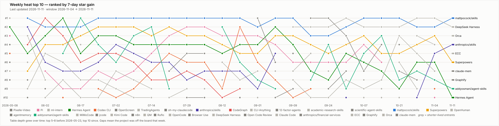

# Category Rankings

[English](../README.md) | [中文](../zh/rankings/README.md)

The home-page [heat ranking](../README.md#recent-heat-ranking) sorts by **weekly star gain** — it shows momentum. The boards on this page sort by **current total stars** — they show the standing stock of each category. Read them together: a project high here but absent from the heat table is established; a project low here but topping the heat table is breaking out.

> **Last updated:** 2026-11-11 · **Star counts:** from the most recent tracked fetch · **Sort:** current total stars, weekly gain shown for reference

> **Note on this edition's "Weekly gain" column:** the figures below cover **2026-11-04 → 2026-11-11**: 7 calendar days, about 7.17 by fetch time, against about 7.45 in the previous edition, so raw gains understate any speed-up by about 4%. Graphify, ECC, Orca, claude-mem and Paperclip, tracked since 11-03, show their first measured gain here, so their column has no earlier window to compare with.

## Ranking Trend

How the weekly heat top 10 has shifted since tracking began — each line is one project, higher is a better rank, breaks mean the project fell off the board that week:

  

The through-line so far: Hermes Agent owned the early boards, the `.claude/skills` wave took over from late May, and from mid-June the top three ranks rotated almost entirely among curated skills collections. **That line bent in September.** For two consecutive windows (2026-09-17 and 2026-09-24) both top-two seats were held by coding agents — [Open Code Review](../agents/open-code-review.md) and [DeepSeek Harness](../agents/deepseek-harness.md) — the first all-agent top two since **2026-05-08**, before the wave began. On 2026-09-30 the top two split again — DeepSeek Harness took its first #1 with [mattpocock/skills](https://github.com/mattpocock/skills) at #2 — and on 2026-10-07 they swapped back, mattpocock retaking #1. The wave rose to five of ten on 09-30 on the strength of two `anthropics/*` collections, then fell to **three** on 10-07 when both left; what remains is the three general collections that have carried it since June. Read the wave as durable but narrow, not as broadening. And read single-window jumps with care, because the board's own record on them is poor — jcode, addyosmani, Codex CLI, K-Dense, TradingAgents, Claude Code and, most recently, CLI-Anything all fell back the window after the one that made them look like a trend. Open Code Review and anthropics/financial-services are the counterexamples that held a second window; both then kept falling — Open Code Review for three windows running, financial-services off the board by its third. On 2026-10-14 the picture firmed up rather than moved: mattpocock/skills held #1 on its largest 7-day gain on record (+11,878) and DeepSeek Harness held #2 on a fourth straight slowdown; the wave rose to **four** seats as [academic-research-skills](https://github.com/Imbad0202/academic-research-skills) returned, and the spike rule paid out once more (OpenHuman gave back 65% the window after its ~12x jump) while Open Code Review, the counterexample, re-accelerated 93% after three slowdowns. On 2026-10-21 the top held and the middle churned: mattpocock/skills kept #1 a third straight window, DeepSeek Harness kept #2 and passed Hermes Agent in total stars, and [OpenCode](../agents/opencode.md) jumped to #3 on its 2.0 launch. Below them, three repos gained 4.7 to 7.5 times their previous window with no documented cause (K-Dense, CLI-Anything, Ruflo), giving the infra layer two seats for the first time since 08-27, and Open Code Review gave back 76% and left — so it, too, did not hold. [Pi](../agents/pi.md)'s 20-window run ended, the longest run on the board ever to end; Hermes Agent (27, every window), Superpowers and mattpocock/skills (22 each) are the runs still going. On 2026-10-28 the board cooled hard (15 of 57 repos accelerated, 42 slowed) and the spike rule paid out on all three of the previous window's unexplained jumps: K-Dense gave back 68% and left, CLI-Anything and Ruflo gave back 56% and 52% but kept seats because the bar fell too, and even OpenCode's documented breakout halved. DeepSeek Harness took #1 for the second time on a flat gain as mattpocock/skills slowed 38% — mattpocock crossed 300k but stayed behind Superpowers — and TradingAgents became the new unexplained spike at #3. The wave held four seats, all general collections for the first time since 08-27; Hermes Agent (28), Superpowers and mattpocock/skills (23 each) are the runs still going. The 2026-11-04 edition replaced one dated 11-03 that ran a day early. By fetch time its window ran about 7.45 days against about 6.24, and on that basis the top held steady, with 21 of 57 repos accelerating: DeepSeek Harness held #1 for the first time, Superpowers rose 46% with no documented cause and now leads mattpocock/skills by 324, and last window's spikes split, TradingAgents keeping a seat at #4 while Gemini CLI gave back 89%. Infra lost both seats. The wave held four seats, all general collections for a second straight window; Hermes Agent (29), Superpowers and mattpocock/skills (24 each) are the runs still going. On 2026-11-11 [mattpocock/skills](https://github.com/mattpocock/skills) retook #1 on a 45% speed-up and passed Superpowers in total stars, while Superpowers gave back 29%, so its 11-04 jump was one more spike that did not hold; TradingAgents slowed again and left. Four of the five repos that entered tracking on 11-03 took seats on their first measured gain ([Orca](../agents/orca.md) #3, [ECC](../agents/ecc.md) #5, [claude-mem](../agents/claude-mem.md) #7, [Graphify](../agents/graphify.md) #8), which reads as the coverage gap closing rather than a breakout. That left the most unusual mix on record: infra three seats (the most in 30 windows), the wave five (all general collections, a first) and agents two (tying the fewest, 05-22). Hermes Agent (30), Superpowers and mattpocock/skills (25 each) are the runs still going.

## Agent Board

End-to-end agents — products you point at a task. Verticals are ranked separately in [agent verticals](agent-verticals.md).

<!-- auto:board:agent -->
| Rank | Project | Vertical | Stars | Weekly gain | Map status |
| --- | --- | --- | --- | --- | --- |
| #1 | [OpenClaw](https://github.com/openclaw/openclaw) | General assistant | 394.3k | +445 | In scope · [profile](../agents/openclaw.md) |
| #2 | [DeepSeek Harness](https://github.com/deepseek-ai/deepseek-harness) | Coding | 278.5k | +7,164 | In scope · [profile](../agents/deepseek-harness.md) |
| #3 | [Hermes Agent](https://github.com/nousresearch/hermes-agent) | General assistant | 262.5k | +2,248 | In scope · [profile](../agents/hermes-agent.md) |
| #4 | [OpenCode](https://github.com/anomalyco/opencode) | Coding | 226.0k | +1,577 | In scope · [profile](../agents/opencode.md) |
| #5 | [AutoGPT](https://github.com/significant-gravitas/autogpt) | General assistant | 188.0k | +101 | In scope · [profile](../agents/autogpt.md) |
| #6 | [Claude Code](https://github.com/anthropics/claude-code) | Coding | 155.2k | +787 | In scope · [profile](../agents/claude-code.md) |
| #7 | [Codex CLI](https://github.com/openai/codex) | Coding | 134.8k | +1,777 | In scope · [profile](../agents/codex.md) |
| #8 | [TradingAgents](https://github.com/tauricresearch/tradingagents) | Finance | 121.9k | +1,527 | Out of scope |
| #9 | [Pi](https://github.com/earendil-works/pi) | Coding | 121.3k | +1,459 | In scope · [profile](../agents/pi.md) |
| #10 | [Browser Use](https://github.com/browser-use/browser-use) | General assistant | 120.7k | +686 | In scope · [profile](../agents/browser-use.md) |
| #11 | [Gemini CLI](https://github.com/google-gemini/gemini-cli) | Coding | 108.8k | +59 | In scope · [profile](../agents/gemini-cli.md) |
| #12 | [OpenHands](https://github.com/openhands/openhands) | Coding | 93.2k | +580 | In scope · [profile](../agents/openhands.md) |
| #13 | [Cline](https://github.com/cline/cline) | Coding | 71.5k | +241 | In scope · [profile](../agents/cline.md) |
| #14 | [Open Interpreter](https://github.com/openinterpreter/openinterpreter) | General assistant | 68.9k | +68 | In scope · [profile](../agents/open-interpreter.md) |
| #15 | [Goose](https://github.com/aaif-goose/goose) | General assistant | 56.4k | +250 | In scope · [profile](../agents/goose.md) |
| #16 | [Aider](https://github.com/aider-ai/aider) | Coding | 50.1k | +129 | In scope · [profile](../agents/aider.md) |
| #17 | [Open Code Review](https://github.com/alibaba/open-code-review) | Coding | 49.8k | +441 | In scope · [profile](../agents/open-code-review.md) |
| #18 | [OpenHuman](https://github.com/tinyhumansai/openhuman) | General assistant | 42.6k | +114 | In scope · [profile](../agents/openhuman.md) |
| #19 | [CodeWhale](https://github.com/codewhale-hq/codewhale) | Coding | 41.2k | +13 | In scope · [profile](../agents/codewhale.md) |
| #20 | [Continue](https://github.com/continuedev/continue) | Coding | 36.5k | +51 | In scope · [profile](../agents/continue.md) |
| #21 | [Qwen Code](https://github.com/qwenlm/qwen-code) | Coding | 29.3k | +312 | In scope · [profile](../agents/qwen-code.md) |
| #22 | [Grok Build](https://github.com/xai-org/grok-build) | Coding | 27.7k | +63 | In scope · [profile](../agents/grok-build.md) |
| #23 | [jcode](https://github.com/1jehuang/jcode) | Coding | 21.7k | +242 | In scope · [profile](../agents/jcode.md) |
| #24 | [SWE-agent](https://github.com/swe-agent/swe-agent) | Coding | 20.8k | +64 | In scope · [profile](../agents/swe-agent.md) |
| #25 | [OpenHarness](https://github.com/hkuds/openharness) | Coding | 16.2k | +31 | In scope · [profile](../agents/openharness.md) |
| #26 | [QM](https://github.com/yc-software/qm) | General assistant | 15.7k | +50 | In scope · [profile](../agents/qm.md) |
| #27 | [MiMoCode](https://github.com/xiaomimimo/mimo-code) | Coding | 13.8k | +35 | In scope · [profile](../agents/mimocode.md) |
| #28 | [Omnigent](https://github.com/omnigent-ai/omnigent) | Coding | 11.3k | +137 | In scope · [profile](../agents/omnigent.md) |
| #29 | [mini-swe-agent](https://github.com/swe-agent/mini-swe-agent) | Coding | 9.5k | +462 | In scope · [profile](../agents/mini-swe-agent.md) |
| #30 | [ZCode](https://github.com/zai-org/zcode) | Coding | 8.6k | +143 | In scope · [profile](../agents/zcode.md) |
| #31 | [Kimi Code](https://github.com/moonshotai/kimi-code) | Coding | 8.2k | +72 | In scope · [profile](../agents/kimi-code.md) |
| #32 | [CoStrict](https://github.com/zgsm-ai/costrict) | Coding | 4.5k | +5 | In scope · [profile](../agents/costrict.md) |
<!-- /auto:board:agent -->

## Agent Infra Board

The layer under the agents — frameworks, orchestration, memory and context, gateways, and workflow engines. These are not agents you "run at a task"; they are what agent builders assemble on.

<!-- auto:board:infra -->
| Rank | Project | Group | Stars | Weekly gain | Map status |
| --- | --- | --- | --- | --- | --- |
| #1 | [n8n](https://github.com/n8n-io/n8n) | Workflow | 210.1k | +586 | In scope · [profile](../agents/n8n.md) |
| #2 | [LangChain](https://github.com/langchain-ai/langchain) | Framework | 149.3k | +361 | In scope · [profile](../agents/langchain.md) |
| #3 | [Graphify](https://github.com/graphify-labs/graphify) | Memory & context | 145.8k | +3,884 | In scope · [profile](../agents/graphify.md) |
| #4 | [Orca](https://github.com/stablyai/orca) | Orchestration | 121.7k | +7,099 | In scope · [profile](../agents/orca.md) |
| #5 | [claude-mem](https://github.com/thedotmack/claude-mem) | Memory & context | 115.9k | +3,900 | In scope · [profile](../agents/claude-mem.md) |
| #6 | [Paperclip](https://github.com/paperclipai/paperclip) | Orchestration | 113.0k | +2,156 | In scope · [profile](../agents/paperclip.md) |
| #7 | [Ruflo](https://github.com/ruvnet/ruflo) | Orchestration | 81.5k | +645 | In scope · [profile](../agents/ruflo.md) |
| #8 | [CodeGraph](https://github.com/colbymchenry/codegraph) | Memory & context | 77.4k | +922 | In scope · [profile](../agents/codegraph.md) |
| #9 | [LiteLLM](https://github.com/berriai/litellm) | Gateway & runtime | 63.1k | +428 | In scope · [profile](../agents/litellm.md) |
| #10 | [CrewAI](https://github.com/crewaiinc/crewai) | Framework | 60.8k | +287 | In scope · [profile](../agents/crewai.md) |
| #11 | [CLI-Anything](https://github.com/hkuds/cli-anything) | Gateway & runtime | 58.6k | +382 | In scope · [profile](../agents/cli-anything.md) |
| #12 | [Flowise](https://github.com/flowiseai/flowise) | Workflow | 55.6k | +21 | In scope · [profile](../agents/flowise.md) |
| #13 | [LlamaIndex](https://github.com/run-llama/llama_index) | Framework | 52.9k | +74 | In scope · [profile](../agents/llamaindex.md) |
| #14 | [LangGraph](https://github.com/langchain-ai/langgraph) | Orchestration | 44.8k | +360 | In scope · [profile](../agents/langgraph.md) |
| #15 | [Langfuse](https://github.com/langfuse/langfuse) | Observability & evals | 37.3k | +310 | In scope · [profile](../agents/langfuse.md) |
| #16 | [agentmemory](https://github.com/rohitg00/agentmemory) | Memory & context | 30.3k | +158 | Watchlist |
| #17 | [Letta (MemGPT)](https://github.com/letta-ai/letta) | Memory & context | 25.4k | +70 | In scope · [profile](../agents/memgpt.md) |
| #18 | [Microsoft Agent Framework](https://github.com/microsoft/agent-framework) | Framework | 14.6k | +100 | In scope · [profile](../agents/microsoft-agent-framework.md) |
| #19 | [Trail Code (Graft)](https://github.com/trailhq/trail-code) | Memory & context | 11.2k | +120 | In scope · [profile](../agents/graft.md) |
| #20 | [TrueForge](https://github.com/truefoundry/trueforge) | Framework | 6.5k | +31 | In scope · [profile](../agents/trueforge.md) |
| #21 | [eve](https://github.com/vercel/eve) | Framework | 5.8k | +61 | In scope · [profile](../agents/eve.md) |
<!-- /auto:board:infra -->

## Skill Board

Skill collections, skill frameworks, and agent methodology — content assets rather than agent surfaces. Most are tracked as watchlist entries; the framework end is profiled through [Superpowers](../agents/superpowers.md). Focus areas are ranked separately in [skill verticals](skill-verticals.md).

<!-- auto:board:skill -->
| Rank | Project | Focus | Stars | Weekly gain | Map status |
| --- | --- | --- | --- | --- | --- |
| #1 | [mattpocock/skills](https://github.com/mattpocock/skills) | Curated collections | 321.2k | +9,640 | Watchlist |
| #2 | [Superpowers](https://github.com/obra/superpowers) | Curated collections | 315.9k | +3,959 | In scope · [profile](../agents/superpowers.md) |
| #3 | [ECC](https://github.com/affaan-m/ecc) | Curated collections | 300.9k | +4,333 | In scope · [profile](../agents/ecc.md) |
| #4 | [anthropics/skills](https://github.com/anthropics/skills) | Curated collections | 192.6k | +5,472 | Watchlist |
| #5 | [addyosmani/agent-skills](https://github.com/addyosmani/agent-skills) | Curated collections | 115.4k | +2,315 | Watchlist |
| #6 | [scientific-agent-skills](https://github.com/k-dense-ai/scientific-agent-skills) | Academic & scientific | 56.8k | +778 | Watchlist |
| #7 | [academic-research-skills](https://github.com/imbad0202/academic-research-skills) | Academic & scientific | 56.4k | +1,163 | Watchlist |
| #8 | [anthropics/financial-services](https://github.com/anthropics/financial-services) | Finance | 41.2k | +188 | Out of scope |
| #9 | [12-factor-agents](https://github.com/humanlayer/12-factor-agents) | Methodology | 27.1k | +124 | Out of scope |
<!-- /auto:board:skill -->

## Vertical Rankings

- [Agent verticals](agent-verticals.md) — coding, general assistant, finance
- [Skill verticals](skill-verticals.md) — curated collections, academic & scientific research, finance, methodology

Boards and the trend chart are regenerated by `scripts/render-rankings.py` and `scripts/render-trend.py` on every publish — do not edit the marked table blocks by hand.
