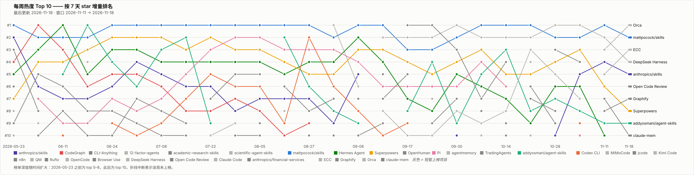

# 分类排行

[English](../../rankings/README.md) | [中文](../README.md)

主页的[热门榜](../README.md#近期热门榜)按 **周增量** 排序，看的是势头；这一页的榜单按 **当前 star 总量** 排序，看的是各类别的存量格局。两边对照读：总量高但没进热榜的项目是已站稳的老玩家，总量低但冲上热榜的项目是正在爆发的新势力。

> **最后更新：** 2026-11-25 · **Star 总数：** 来自最近一次追踪抓取 · **排序：** 当前 star 总量，本周增量仅作参考

> **本期"周增量"列的说明：** 下面的数字覆盖 **2026-11-18 → 2026-11-25**：日历 7 天，按抓取时间约 7.28 天，上一期约 7.07 天，所以原始增量会把提速多算约 3%。DeerFlow 与 nanobot 本次抓取起进入跟踪，本期没有增量。Microsoft Agent Framework 的仓库仍返回 404，继续暂停跟踪。

## 排名趋势

每周热度 Top 10 自开始追踪以来的名次变化——一条折线一个项目，越靠上名次越好，折线中断表示该周掉出榜单：

  

到目前为止的主线：早期榜单由 Hermes Agent 统治，5 月底起 `.claude/skills` 浪潮接管，6 月中以后前三名几乎完全在 curated skills 合集之间轮换。**这条线在 9 月被掰弯了。** 连续两个窗口（2026-09-17 与 2026-09-24），增量榜前两席都由 coding agent 占住——[Open Code Review](../agents/open-code-review.md) 与 [DeepSeek Harness](../agents/deepseek-harness.md)——这是自 **2026-05-08**、也就是这波浪潮开始之前，第一次出现前二全是 agent。2026-09-30 这一期前二又分开了——DeepSeek Harness 拿到它的第一个 #1，[mattpocock/skills](https://github.com/mattpocock/skills) 排 #2——到 2026-10-07 两者又换了回来，mattpocock 重回 #1。浪潮在 09-30 靠两个 `anthropics/*` 集合升到十席中的五席，10-07 两者都离榜后又降到**三席**；留下的是自 6 月以来一直撑着它的三个通用集合。现在的形态该读成"浪潮持久但收窄"，而不是"在扩散"。同时对单窗口跳增要格外当心，因为本榜自己的记录并不好看——jcode、addyosmani、Codex CLI、K-Dense、TradingAgents、Claude Code、CLI-Anything（10-21）、Superpowers（11-04），以及最近的 Open Code Review（11-18），都在那个让它们看起来像趋势的窗口之后的下一期回落了。Open Code Review 与 anthropics/financial-services 是扛过第二个窗口的反例；但两者随后都一路下滑——Open Code Review 连续三个窗口放缓，financial-services 到第三个窗口已经掉出榜外。2026-10-14 这一期的格局是坐实而不是移动：mattpocock/skills 以它有记录以来最大的 7 天增量（+11,878）守住 #1，DeepSeek Harness 在连续第四次放缓中守住 #2；浪潮随 [academic-research-skills](https://github.com/Imbad0202/academic-research-skills) 回榜升到**四席**；尖峰规矩又兑现一次（OpenHuman 在约 12 倍跳增的下一期还回 65%），而作为反例的 Open Code Review 在三次放缓之后重新加速 93%。2026-10-21 这一期是榜首稳、中段乱：mattpocock/skills 连续第三个窗口守住 #1，DeepSeek Harness 守住 #2 并在总 star 上反超 Hermes Agent，[OpenCode](../agents/opencode.md) 随 2.0 发布跳到 #3。再往下，三个仓库的增量是上期的 4.7 到 7.5 倍，却查不到原因（K-Dense、CLI-Anything、Ruflo），让 infra 层自 08-27 以来第一次拿到两席；Open Code Review 还回 76% 离榜——它也没扛住。[Pi](../agents/pi.md) 连续 20 个窗口在榜就此结束，是本榜有史以来结束的最长连续在榜；还在跑的是 Hermes Agent（27，每个窗口都在）、Superpowers 与 mattpocock/skills（各 22）。2026-10-28 全榜明显降温（57 个仓库里 15 个加速、42 个放缓），尖峰规则在上期三个原因查不到的跳涨上全部兑现：K-Dense 还回 68% 离榜，CLI-Anything 与 Ruflo 分别还回 56% 和 52%，但因为门槛也降了而保住席位，就连 OpenCode 那次有据可查的爆发也砍半。mattpocock/skills 放缓 38%，DeepSeek Harness 增量持平而第二次拿下 #1——mattpocock 越过 30 万，但仍落后 Superpowers——TradingAgents 成了新的原因不明的尖峰，排 #3。浪潮保住四席，08-27 以来第一次全是通用集合；还在跑的是 Hermes Agent（28）、Superpowers 与 mattpocock/skills（各 23）。2026-11-04 这一期取代了提前一天跑的 11-03 那一期。按抓取时间，这个窗口约 7.45 天，上个窗口约 6.24 天，换算后榜首一带是稳住，57 个仓库里 21 个加速：DeepSeek Harness 第一次守住 #1，Superpowers 涨 46% 却查不到原因，现在只领先 mattpocock/skills 324，上期的尖峰分了岔，TradingAgents 保住 #4，Gemini CLI 还回 89%。infra 丢掉两席。浪潮保住四席，连续第二个窗口全是通用集合；还在跑的是 Hermes Agent（29）、Superpowers 与 mattpocock/skills（各 24）。2026-11-11 那期，[mattpocock/skills](https://github.com/mattpocock/skills) 提速 45% 重回 #1，总 star 超过 Superpowers；Superpowers 还回 29%，所以它 11-04 的跳增又是一次没能延续的尖峰；TradingAgents 再次放缓并离榜。11-03 进入跟踪的五个仓库里有四个在第一个可测窗口就进了前十（[Orca](../agents/orca.md) #3、[ECC](../agents/ecc.md) #5、[claude-mem](../agents/claude-mem.md) #7、[Graphify](../agents/graphify.md) #8），应读作覆盖缺口在补上，而不是爆发。于是出现了有记录以来最少见的结构：infra 三席（30 个窗口里最多），浪潮五席（第一次全是通用集合），agent 两席（追平最少纪录，05-22）。还在跑的是 Hermes Agent（30）、Superpowers 与 mattpocock/skills（各 25）。2026-11-18 全榜降温（60 个仓库里 23 个加速、37 个放缓），[Orca](../agents/orca.md) 增量持平却拿下 #1，是继 06-02 的 CodeGraph 之后第二个拿到 #1 的 infra 仓库；mattpocock/skills 还回 39%，DeepSeek Harness 降 31% 到 #4，是它进入跟踪以来最低的名次。Hermes Agent 的连续在榜停在 30 个窗口，也就是本榜记录过的每一个窗口；Superpowers 与 mattpocock/skills（各 26）现在是仍在继续的最长连续。Open Code Review 以 866% 的跳增回到 #6，查不到原因，是新的尖峰。结构没变：浪潮五席（全是通用集合），infra 三席，agent 两席。2026-11-25 这期，Orca 守住 #1（涨 38%），是第一个连续两个窗口坐 #1 的 infra 仓库；随着 CLI-Anything 回榜、Paperclip 第一次进前十，infra 以四席创下纪录。Superpowers（涨 76%，到 #2）和 CLI-Anything（涨 763%，到 #3）的跳涨在窗口里都没有提交或发版对应，所以都算尖峰；Open Code Review 还回 48% 但守住 #10。mattpocock/skills（#4）和 DeepSeek Harness（#6）都排到有记录以来最低的名次，addyosmani/agent-skills 的连续在榜停在 10 个窗口。仍在继续的最长连续是 Superpowers 与 mattpocock/skills（各 27）。结构：infra 四席，浪潮四席（全是通用集合），agent 两席。

## Agent 榜

端到端的 agent——拿来直接干活的产品。垂类细分见 [Agent 垂类排行](agent-verticals.md)。

<!-- auto:board:agent -->
| 排名 | 项目 | 垂类 | Stars | 本周增量 | 状态 |
| --- | --- | --- | --- | --- | --- |
| #1 | [OpenClaw](https://github.com/openclaw/openclaw) | 通用助理 | 395.2k | +485 | 已收录 · [profile](../agents/openclaw.md) |
| #2 | [DeepSeek Harness](https://github.com/deepseek-ai/deepseek-harness) | 编程开发 | 286.9k | +3,611 | 已收录 · [profile](../agents/deepseek-harness.md) |
| #3 | [Hermes Agent](https://github.com/nousresearch/hermes-agent) | 通用助理 | 266.0k | +1,708 | 已收录 · [profile](../agents/hermes-agent.md) |
| #4 | [OpenCode](https://github.com/anomalyco/opencode) | 编程开发 | 229.1k | +1,427 | 已收录 · [profile](../agents/opencode.md) |
| #5 | [AutoGPT](https://github.com/significant-gravitas/autogpt) | 通用助理 | 188.2k | +101 | 已收录 · [profile](../agents/autogpt.md) |
| #6 | [Claude Code](https://github.com/anthropics/claude-code) | 编程开发 | 157.0k | +936 | 已收录 · [profile](../agents/claude-code.md) |
| #7 | [Codex CLI](https://github.com/openai/codex) | 编程开发 | 136.4k | +692 | 已收录 · [profile](../agents/codex.md) |
| #8 | [Pi](https://github.com/earendil-works/pi) | 编程开发 | 123.8k | +1,208 | 已收录 · [profile](../agents/pi.md) |
| #9 | [TradingAgents](https://github.com/tauricresearch/tradingagents) | 金融 | 123.8k | +726 | 不收录 |
| #10 | [Browser Use](https://github.com/browser-use/browser-use) | 通用助理 | 122.0k | +652 | 已收录 · [profile](../agents/browser-use.md) |
| #11 | [Gemini CLI](https://github.com/google-gemini/gemini-cli) | 编程开发 | 109.1k | +189 | 已收录 · [profile](../agents/gemini-cli.md) |
| #12 | [OpenHands](https://github.com/openhands/openhands) | 编程开发 | 94.3k | +600 | 已收录 · [profile](../agents/openhands.md) |
| #13 | [DeerFlow](https://github.com/bytedance/deer-flow) | 通用助理 | 85.8k | — | 已收录 · [profile](../agents/deer-flow.md) |
| #14 | [Cline](https://github.com/cline/cline) | 编程开发 | 71.9k | +148 | 已收录 · [profile](../agents/cline.md) |
| #15 | [Open Interpreter](https://github.com/openinterpreter/openinterpreter) | 通用助理 | 69.0k | +57 | 已收录 · [profile](../agents/open-interpreter.md) |
| #16 | [Goose](https://github.com/aaif-goose/goose) | 通用助理 | 57.0k | +235 | 已收录 · [profile](../agents/goose.md) |
| #17 | [Open Code Review](https://github.com/alibaba/open-code-review) | 编程开发 | 56.3k | +2,261 | 已收录 · [profile](../agents/open-code-review.md) |
| #18 | [nanobot](https://github.com/hkuds/nanobot) | 通用助理 | 50.3k | — | 已收录 · [profile](../agents/nanobot.md) |
| #19 | [Aider](https://github.com/aider-ai/aider) | 编程开发 | 50.3k | +94 | 已收录 · [profile](../agents/aider.md) |
| #20 | [OpenHuman](https://github.com/tinyhumansai/openhuman) | 通用助理 | 42.8k | +104 | 已收录 · [profile](../agents/openhuman.md) |
| #21 | [CodeWhale](https://github.com/codewhale-hq/codewhale) | 编程开发 | 41.2k | +24 | 已收录 · [profile](../agents/codewhale.md) |
| #22 | [Continue](https://github.com/continuedev/continue) | 编程开发 | 36.6k | +52 | 已收录 · [profile](../agents/continue.md) |
| #23 | [Qwen Code](https://github.com/qwenlm/qwen-code) | 编程开发 | 30.9k | +188 | 已收录 · [profile](../agents/qwen-code.md) |
| #24 | [Grok Build](https://github.com/xai-org/grok-build) | 编程开发 | 27.9k | +54 | 已收录 · [profile](../agents/grok-build.md) |
| #25 | [jcode](https://github.com/1jehuang/jcode) | 编程开发 | 22.0k | +165 | 已收录 · [profile](../agents/jcode.md) |
| #26 | [SWE-agent](https://github.com/swe-agent/swe-agent) | 编程开发 | 20.9k | +43 | 已收录 · [profile](../agents/swe-agent.md) |
| #27 | [OpenHarness](https://github.com/hkuds/openharness) | 编程开发 | 16.2k | +11 | 已收录 · [profile](../agents/openharness.md) |
| #28 | [QM](https://github.com/yc-software/qm) | 通用助理 | 15.8k | +55 | 已收录 · [profile](../agents/qm.md) |
| #29 | [MiMoCode](https://github.com/xiaomimimo/mimo-code) | 编程开发 | 13.8k | +7 | 已收录 · [profile](../agents/mimocode.md) |
| #30 | [Omnigent](https://github.com/omnigent-ai/omnigent) | 编程开发 | 11.6k | +140 | 已收录 · [profile](../agents/omnigent.md) |
| #31 | [mini-swe-agent](https://github.com/swe-agent/mini-swe-agent) | 编程开发 | 10.1k | +338 | 已收录 · [profile](../agents/mini-swe-agent.md) |
| #32 | [ZCode](https://github.com/zai-org/zcode) | 编程开发 | 8.9k | +168 | 已收录 · [profile](../agents/zcode.md) |
| #33 | [Kimi Code](https://github.com/moonshotai/kimi-code) | 编程开发 | 8.3k | +47 | 已收录 · [profile](../agents/kimi-code.md) |
| #34 | [CoStrict](https://github.com/zgsm-ai/costrict) | 编程开发 | 4.5k | +-1 | 已收录 · [profile](../agents/costrict.md) |
<!-- /auto:board:agent -->

## Agent 基础设施榜

agent 之下的那一层——框架、编排、记忆与上下文、网关和工作流引擎。它们不是"指着任务就能跑"的 agent，而是 agent 开发者用来搭建系统的底座。

<!-- auto:board:infra -->
| 排名 | 项目 | 分组 | Stars | 本周增量 | 状态 |
| --- | --- | --- | --- | --- | --- |
| #1 | [n8n](https://github.com/n8n-io/n8n) | 工作流 | 212.1k | +1,298 | 已收录 · [profile](../agents/n8n.md) |
| #2 | [Graphify](https://github.com/graphify-labs/graphify) | 记忆与上下文 | 153.2k | +3,392 | 已收录 · [profile](../agents/graphify.md) |
| #3 | [LangChain](https://github.com/langchain-ai/langchain) | 框架 | 150.0k | +144 | 已收录 · [profile](../agents/langchain.md) |
| #4 | [Orca](https://github.com/stablyai/orca) | 编排 | 137.5k | +9,266 | 已收录 · [profile](../agents/orca.md) |
| #5 | [claude-mem](https://github.com/thedotmack/claude-mem) | 记忆与上下文 | 119.7k | +1,608 | 已收录 · [profile](../agents/claude-mem.md) |
| #6 | [Paperclip](https://github.com/paperclipai/paperclip) | 编排 | 117.0k | +2,291 | 已收录 · [profile](../agents/paperclip.md) |
| #7 | [Ruflo](https://github.com/ruvnet/ruflo) | 编排 | 82.4k | +406 | 已收录 · [profile](../agents/ruflo.md) |
| #8 | [CodeGraph](https://github.com/colbymchenry/codegraph) | 记忆与上下文 | 78.7k | +751 | 已收录 · [profile](../agents/codegraph.md) |
| #9 | [CLI-Anything](https://github.com/hkuds/cli-anything) | 网关与执行 | 65.5k | +6,191 | 已收录 · [profile](../agents/cli-anything.md) |
| #10 | [LiteLLM](https://github.com/berriai/litellm) | 网关与执行 | 63.9k | +426 | 已收录 · [profile](../agents/litellm.md) |
| #11 | [CrewAI](https://github.com/crewaiinc/crewai) | 框架 | 61.3k | +195 | 已收录 · [profile](../agents/crewai.md) |
| #12 | [Flowise](https://github.com/flowiseai/flowise) | 工作流 | 55.6k | +18 | 已收录 · [profile](../agents/flowise.md) |
| #13 | [LlamaIndex](https://github.com/run-llama/llama_index) | 框架 | 53.0k | +64 | 已收录 · [profile](../agents/llamaindex.md) |
| #14 | [LangGraph](https://github.com/langchain-ai/langgraph) | 编排 | 45.4k | +310 | 已收录 · [profile](../agents/langgraph.md) |
| #15 | [Langfuse](https://github.com/langfuse/langfuse) | 观测与评估 | 37.8k | +256 | 已收录 · [profile](../agents/langfuse.md) |
| #16 | [agentmemory](https://github.com/rohitg00/agentmemory) | 记忆与上下文 | 30.6k | +145 | 候补 |
| #17 | [Letta (MemGPT)](https://github.com/letta-ai/letta) | 记忆与上下文 | 25.5k | +66 | 已收录 · [profile](../agents/memgpt.md) |
| #18 | [Trail Code (Graft)](https://github.com/trailhq/trail-code) | 记忆与上下文 | 11.5k | +158 | 已收录 · [profile](../agents/graft.md) |
| #19 | [TrueForge](https://github.com/truefoundry/trueforge) | 框架 | 6.6k | +136 | 已收录 · [profile](../agents/trueforge.md) |
| #20 | [eve](https://github.com/vercel/eve) | 框架 | 6.1k | +122 | 已收录 · [profile](../agents/eve.md) |
<!-- /auto:board:infra -->

## Skill 榜

skill 合集、skill 框架和 agent 方法论——内容资产而非 agent 表面。多数作为候补跟踪；框架那一端通过 [Superpowers](../agents/superpowers.md) 的 profile 覆盖。方向细分见 [Skill 垂类排行](skill-verticals.md)。

<!-- auto:board:skill -->
| 排名 | 项目 | 方向 | Stars | 本周增量 | 状态 |
| --- | --- | --- | --- | --- | --- |
| #1 | [mattpocock/skills](https://github.com/mattpocock/skills) | 通用技能集 | 332.7k | +5,645 | 候补 |
| #2 | [Superpowers](https://github.com/obra/superpowers) | 通用技能集 | 326.4k | +6,753 | 已收录 · [profile](../agents/superpowers.md) |
| #3 | [ECC](https://github.com/affaan-m/ecc) | 通用技能集 | 310.5k | +4,633 | 已收录 · [profile](../agents/ecc.md) |
| #4 | [anthropics/skills](https://github.com/anthropics/skills) | 通用技能集 | 200.3k | +3,396 | 候补 |
| #5 | [addyosmani/agent-skills](https://github.com/addyosmani/agent-skills) | 通用技能集 | 120.4k | +1,603 | 候补 |
| #6 | [academic-research-skills](https://github.com/imbad0202/academic-research-skills) | 学术科研 | 58.5k | +1,143 | 候补 |
| #7 | [scientific-agent-skills](https://github.com/k-dense-ai/scientific-agent-skills) | 学术科研 | 58.5k | +810 | 候补 |
| #8 | [anthropics/financial-services](https://github.com/anthropics/financial-services) | 金融 | 41.5k | +134 | 不收录 |
| #9 | [12-factor-agents](https://github.com/humanlayer/12-factor-agents) | 方法论 | 27.4k | +132 | 不收录 |
<!-- /auto:board:skill -->

## 垂类排行

- [Agent 垂类排行](agent-verticals.md)——编程开发、通用助理、金融
- [Skill 垂类排行](skill-verticals.md)——通用技能集、学术科研、金融、方法论

本页表格和趋势图由 `scripts/render-rankings.py` 与 `scripts/render-trend.py` 在每次发布时自动重新生成——标记块内的表格不要手工编辑。
