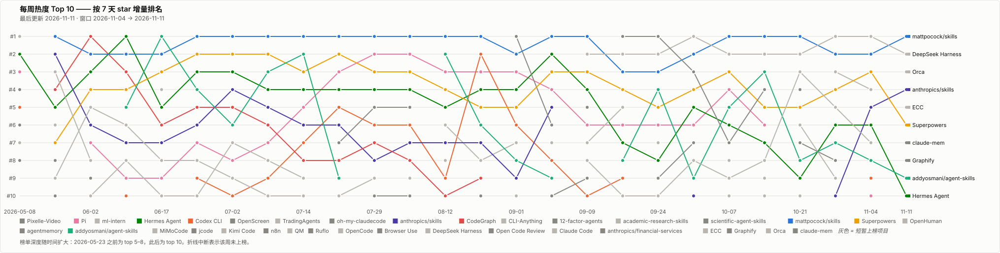

# 分类排行

[English](../../rankings/README.md) | [中文](../README.md)

主页的[热门榜](../README.md#近期热门榜)按 **周增量** 排序，看的是势头；这一页的榜单按 **当前 star 总量** 排序，看的是各类别的存量格局。两边对照读：总量高但没进热榜的项目是已站稳的老玩家，总量低但冲上热榜的项目是正在爆发的新势力。

> **最后更新：** 2026-11-03 · **Star 总数：** 来自最近一次追踪抓取 · **排序：** 当前 star 总量，本周增量仅作参考

> **本期"周增量"列的说明：** 下面的数字覆盖 **2026-10-28 → 2026-11-03（6 天）**，上一期是 **7 天**，两列不能直接比，要先换算成周率（增量 ÷ 6 × 7）。本期进入跟踪的仓库（Graphify、ECC、Orca、claude-mem、Paperclip）下一期才有增量。

## 排名趋势

每周热度 Top 10 自开始追踪以来的名次变化——一条折线一个项目，越靠上名次越好，折线中断表示该周掉出榜单：

  

到目前为止的主线：早期榜单由 Hermes Agent 统治，5 月底起 `.claude/skills` 浪潮接管，6 月中以后前三名几乎完全在 curated skills 合集之间轮换。**这条线在 9 月被掰弯了。** 连续两个窗口（2026-09-17 与 2026-09-24），增量榜前两席都由 coding agent 占住——[Open Code Review](../agents/open-code-review.md) 与 [DeepSeek Harness](../agents/deepseek-harness.md)——这是自 **2026-05-08**、也就是这波浪潮开始之前，第一次出现前二全是 agent。2026-09-30 这一期前二又分开了——DeepSeek Harness 拿到它的第一个 #1，[mattpocock/skills](https://github.com/mattpocock/skills) 排 #2——到 2026-10-07 两者又换了回来，mattpocock 重回 #1。浪潮在 09-30 靠两个 `anthropics/*` 集合升到十席中的五席，10-07 两者都离榜后又降到**三席**；留下的是自 6 月以来一直撑着它的三个通用集合。现在的形态该读成"浪潮持久但收窄"，而不是"在扩散"。同时对单窗口跳增要格外当心，因为本榜自己的记录并不好看——jcode、addyosmani、Codex CLI、K-Dense、TradingAgents、Claude Code，以及最近的 CLI-Anything，都在那个让它们看起来像趋势的窗口之后的下一期回落了。Open Code Review 与 anthropics/financial-services 是扛过第二个窗口的反例；但两者随后都一路下滑——Open Code Review 连续三个窗口放缓，financial-services 到第三个窗口已经掉出榜外。2026-10-14 这一期的格局是坐实而不是移动：mattpocock/skills 以它有记录以来最大的 7 天增量（+11,878）守住 #1，DeepSeek Harness 在连续第四次放缓中守住 #2；浪潮随 [academic-research-skills](https://github.com/Imbad0202/academic-research-skills) 回榜升到**四席**；尖峰规矩又兑现一次（OpenHuman 在约 12 倍跳增的下一期还回 65%），而作为反例的 Open Code Review 在三次放缓之后重新加速 93%。2026-10-21 这一期是榜首稳、中段乱：mattpocock/skills 连续第三个窗口守住 #1，DeepSeek Harness 守住 #2 并在总 star 上反超 Hermes Agent，[OpenCode](../agents/opencode.md) 随 2.0 发布跳到 #3。再往下，三个仓库的增量是上期的 4.7 到 7.5 倍，却查不到原因（K-Dense、CLI-Anything、Ruflo），让 infra 层自 08-27 以来第一次拿到两席；Open Code Review 还回 76% 离榜——它也没扛住。[Pi](../agents/pi.md) 连续 20 个窗口在榜就此结束，是本榜有史以来结束的最长连续在榜；还在跑的是 Hermes Agent（27，每个窗口都在）、Superpowers 与 mattpocock/skills（各 22）。2026-10-28 全榜明显降温（57 个仓库里 15 个加速、42 个放缓），尖峰规则在上期三个原因查不到的跳涨上全部兑现：K-Dense 还回 68% 离榜，CLI-Anything 与 Ruflo 分别还回 56% 和 52%，但因为门槛也降了而保住席位，就连 OpenCode 那次有据可查的爆发也砍半。mattpocock/skills 放缓 38%，DeepSeek Harness 增量持平而第二次拿下 #1——mattpocock 越过 30 万，但仍落后 Superpowers——TradingAgents 成了新的原因不明的尖峰，排 #3。浪潮保住四席，08-27 以来第一次全是通用集合；还在跑的是 Hermes Agent（28）、Superpowers 与 mattpocock/skills（各 23）。2026-11-03（6 天窗口）全榜再度回暖，57 个仓库里 34 个加速：DeepSeek Harness 第一次守住 #1，Superpowers 周率涨 81% 却查不到原因，上期的尖峰分了岔，TradingAgents 保住 #4，Gemini CLI 还回 88%。infra 丢掉两席。浪潮保住四席，连续第二个窗口全是通用集合；还在跑的是 Hermes Agent（29）、Superpowers 与 mattpocock/skills（各 24）。

## Agent 榜

端到端的 agent——拿来直接干活的产品。垂类细分见 [Agent 垂类排行](agent-verticals.md)。

<!-- auto:board:agent -->
| 排名 | 项目 | 垂类 | Stars | 本周增量 | 状态 |
| --- | --- | --- | --- | --- | --- |
| #1 | [OpenClaw](https://github.com/openclaw/openclaw) | 通用助理 | 393.8k | +559 | 已收录 · [profile](../agents/openclaw.md) |
| #2 | [DeepSeek Harness](https://github.com/deepseek-ai/deepseek-harness) | 编程开发 | 269.8k | +6,264 | 已收录 · [profile](../agents/deepseek-harness.md) |
| #3 | [Hermes Agent](https://github.com/nousresearch/hermes-agent) | 通用助理 | 259.9k | +2,252 | 已收录 · [profile](../agents/hermes-agent.md) |
| #4 | [OpenCode](https://github.com/anomalyco/opencode) | 编程开发 | 224.1k | +1,867 | 已收录 · [profile](../agents/opencode.md) |
| #5 | [AutoGPT](https://github.com/significant-gravitas/autogpt) | 通用助理 | 187.9k | +96 | 已收录 · [profile](../agents/autogpt.md) |
| #6 | [Claude Code](https://github.com/anthropics/claude-code) | 编程开发 | 154.3k | +742 | 已收录 · [profile](../agents/claude-code.md) |
| #7 | [Codex CLI](https://github.com/openai/codex) | 编程开发 | 132.9k | +1,648 | 已收录 · [profile](../agents/codex.md) |
| #8 | [TradingAgents](https://github.com/tauricresearch/tradingagents) | 金融 | 120.0k | +2,874 | 不收录 |
| #9 | [Browser Use](https://github.com/browser-use/browser-use) | 通用助理 | 119.9k | +589 | 已收录 · [profile](../agents/browser-use.md) |
| #10 | [Pi](https://github.com/earendil-works/pi) | 编程开发 | 119.6k | +1,392 | 已收录 · [profile](../agents/pi.md) |
| #11 | [Gemini CLI](https://github.com/google-gemini/gemini-cli) | 编程开发 | 108.7k | +116 | 已收录 · [profile](../agents/gemini-cli.md) |
| #12 | [OpenHands](https://github.com/openhands/openhands) | 编程开发 | 92.5k | +528 | 已收录 · [profile](../agents/openhands.md) |
| #13 | [Cline](https://github.com/cline/cline) | 编程开发 | 71.2k | +316 | 已收录 · [profile](../agents/cline.md) |
| #14 | [Open Interpreter](https://github.com/openinterpreter/openinterpreter) | 通用助理 | 68.8k | +90 | 已收录 · [profile](../agents/open-interpreter.md) |
| #15 | [Goose](https://github.com/aaif-goose/goose) | 通用助理 | 56.2k | +335 | 已收录 · [profile](../agents/goose.md) |
| #16 | [Aider](https://github.com/aider-ai/aider) | 编程开发 | 49.9k | +143 | 已收录 · [profile](../agents/aider.md) |
| #17 | [Open Code Review](https://github.com/alibaba/open-code-review) | 编程开发 | 49.3k | +788 | 已收录 · [profile](../agents/open-code-review.md) |
| #18 | [OpenHuman](https://github.com/tinyhumansai/openhuman) | 通用助理 | 42.5k | +134 | 已收录 · [profile](../agents/openhuman.md) |
| #19 | [CodeWhale](https://github.com/codewhale-hq/codewhale) | 编程开发 | 41.2k | +33 | 已收录 · [profile](../agents/codewhale.md) |
| #20 | [Continue](https://github.com/continuedev/continue) | 编程开发 | 36.4k | +50 | 已收录 · [profile](../agents/continue.md) |
| #21 | [Qwen Code](https://github.com/qwenlm/qwen-code) | 编程开发 | 28.9k | +149 | 已收录 · [profile](../agents/qwen-code.md) |
| #22 | [Grok Build](https://github.com/xai-org/grok-build) | 编程开发 | 27.7k | +92 | 已收录 · [profile](../agents/grok-build.md) |
| #23 | [jcode](https://github.com/1jehuang/jcode) | 编程开发 | 21.4k | +182 | 已收录 · [profile](../agents/jcode.md) |
| #24 | [SWE-agent](https://github.com/swe-agent/swe-agent) | 编程开发 | 20.7k | +59 | 已收录 · [profile](../agents/swe-agent.md) |
| #25 | [OpenHarness](https://github.com/hkuds/openharness) | 编程开发 | 16.2k | +45 | 已收录 · [profile](../agents/openharness.md) |
| #26 | [QM](https://github.com/yc-software/qm) | 通用助理 | 15.6k | +65 | 已收录 · [profile](../agents/qm.md) |
| #27 | [MiMoCode](https://github.com/xiaomimimo/mimo-code) | 编程开发 | 13.7k | +9 | 已收录 · [profile](../agents/mimocode.md) |
| #28 | [Omnigent](https://github.com/omnigent-ai/omnigent) | 编程开发 | 11.2k | +97 | 已收录 · [profile](../agents/omnigent.md) |
| #29 | [mini-swe-agent](https://github.com/swe-agent/mini-swe-agent) | 编程开发 | 9.0k | +155 | 已收录 · [profile](../agents/mini-swe-agent.md) |
| #30 | [ZCode](https://github.com/zai-org/zcode) | 编程开发 | 8.4k | +128 | 已收录 · [profile](../agents/zcode.md) |
| #31 | [Kimi Code](https://github.com/moonshotai/kimi-code) | 编程开发 | 8.1k | +74 | 已收录 · [profile](../agents/kimi-code.md) |
| #32 | [CoStrict](https://github.com/zgsm-ai/costrict) | 编程开发 | 4.5k | +2 | 已收录 · [profile](../agents/costrict.md) |
<!-- /auto:board:agent -->

## Agent 基础设施榜

agent 之下的那一层——框架、编排、记忆与上下文、网关和工作流引擎。它们不是"指着任务就能跑"的 agent，而是 agent 开发者用来搭建系统的底座。

<!-- auto:board:infra -->
| 排名 | 项目 | 分组 | Stars | 本周增量 | 状态 |
| --- | --- | --- | --- | --- | --- |
| #1 | [n8n](https://github.com/n8n-io/n8n) | 工作流 | 209.4k | +630 | 已收录 · [profile](../agents/n8n.md) |
| #2 | [LangChain](https://github.com/langchain-ai/langchain) | 框架 | 148.9k | +357 | 已收录 · [profile](../agents/langchain.md) |
| #3 | [Graphify](https://github.com/graphify-labs/graphify) | 记忆与上下文 | 141.3k | — | 已收录 · [profile](../agents/graphify.md) |
| #4 | [Orca](https://github.com/stablyai/orca) | 编排 | 113.7k | — | 已收录 · [profile](../agents/orca.md) |
| #5 | [claude-mem](https://github.com/thedotmack/claude-mem) | 记忆与上下文 | 110.8k | — | 已收录 · [profile](../agents/claude-mem.md) |
| #6 | [Paperclip](https://github.com/paperclipai/paperclip) | 编排 | 110.5k | — | 已收录 · [profile](../agents/paperclip.md) |
| #7 | [Ruflo](https://github.com/ruvnet/ruflo) | 编排 | 80.7k | +954 | 已收录 · [profile](../agents/ruflo.md) |
| #8 | [CodeGraph](https://github.com/colbymchenry/codegraph) | 记忆与上下文 | 76.3k | +670 | 已收录 · [profile](../agents/codegraph.md) |
| #9 | [LiteLLM](https://github.com/berriai/litellm) | 网关与执行 | 62.6k | +422 | 已收录 · [profile](../agents/litellm.md) |
| #10 | [CrewAI](https://github.com/crewaiinc/crewai) | 框架 | 60.4k | +260 | 已收录 · [profile](../agents/crewai.md) |
| #11 | [CLI-Anything](https://github.com/hkuds/cli-anything) | 网关与执行 | 58.1k | +772 | 已收录 · [profile](../agents/cli-anything.md) |
| #12 | [Flowise](https://github.com/flowiseai/flowise) | 工作流 | 55.5k | +15 | 已收录 · [profile](../agents/flowise.md) |
| #13 | [LlamaIndex](https://github.com/run-llama/llama_index) | 框架 | 52.8k | +90 | 已收录 · [profile](../agents/llamaindex.md) |
| #14 | [LangGraph](https://github.com/langchain-ai/langgraph) | 编排 | 44.4k | +360 | 已收录 · [profile](../agents/langgraph.md) |
| #15 | [Langfuse](https://github.com/langfuse/langfuse) | 观测与评估 | 36.9k | +309 | 已收录 · [profile](../agents/langfuse.md) |
| #16 | [agentmemory](https://github.com/rohitg00/agentmemory) | 记忆与上下文 | 30.1k | +158 | 候补 |
| #17 | [Letta (MemGPT)](https://github.com/letta-ai/letta) | 记忆与上下文 | 25.3k | +55 | 已收录 · [profile](../agents/memgpt.md) |
| #18 | [Microsoft Agent Framework](https://github.com/microsoft/agent-framework) | 框架 | 14.5k | +160 | 已收录 · [profile](../agents/microsoft-agent-framework.md) |
| #19 | [Trail Code (Graft)](https://github.com/trailhq/trail-code) | 记忆与上下文 | 11.0k | +225 | 已收录 · [profile](../agents/graft.md) |
| #20 | [TrueForge](https://github.com/truefoundry/trueforge) | 框架 | 6.4k | +36 | 已收录 · [profile](../agents/trueforge.md) |
| #21 | [eve](https://github.com/vercel/eve) | 框架 | 5.8k | +77 | 已收录 · [profile](../agents/eve.md) |
<!-- /auto:board:infra -->

## Skill 榜

skill 合集、skill 框架和 agent 方法论——内容资产而非 agent 表面。多数作为候补跟踪；框架那一端通过 [Superpowers](../agents/superpowers.md) 的 profile 覆盖。方向细分见 [Skill 垂类排行](skill-verticals.md)。

<!-- auto:board:skill -->
| 排名 | 项目 | 方向 | Stars | 本周增量 | 状态 |
| --- | --- | --- | --- | --- | --- |
| #1 | [Superpowers](https://github.com/obra/superpowers) | 通用技能集 | 311.3k | +5,143 | 已收录 · [profile](../agents/superpowers.md) |
| #2 | [mattpocock/skills](https://github.com/mattpocock/skills) | 通用技能集 | 310.3k | +5,633 | 候补 |
| #3 | [ECC](https://github.com/affaan-m/ecc) | 通用技能集 | 295.7k | — | 已收录 · [profile](../agents/ecc.md) |
| #4 | [anthropics/skills](https://github.com/anthropics/skills) | 通用技能集 | 186.8k | +2,626 | 候补 |
| #5 | [addyosmani/agent-skills](https://github.com/addyosmani/agent-skills) | 通用技能集 | 112.8k | +1,807 | 候补 |
| #6 | [scientific-agent-skills](https://github.com/k-dense-ai/scientific-agent-skills) | 学术科研 | 55.8k | +927 | 候补 |
| #7 | [academic-research-skills](https://github.com/imbad0202/academic-research-skills) | 学术科研 | 55.1k | +903 | 候补 |
| #8 | [anthropics/financial-services](https://github.com/anthropics/financial-services) | 金融 | 41.0k | +148 | 不收录 |
| #9 | [12-factor-agents](https://github.com/humanlayer/12-factor-agents) | 方法论 | 27.0k | +64 | 不收录 |
<!-- /auto:board:skill -->

## 垂类排行

- [Agent 垂类排行](agent-verticals.md)——编程开发、通用助理、金融
- [Skill 垂类排行](skill-verticals.md)——通用技能集、学术科研、金融、方法论

本页表格和趋势图由 `scripts/render-rankings.py` 与 `scripts/render-trend.py` 在每次发布时自动重新生成——标记块内的表格不要手工编辑。
